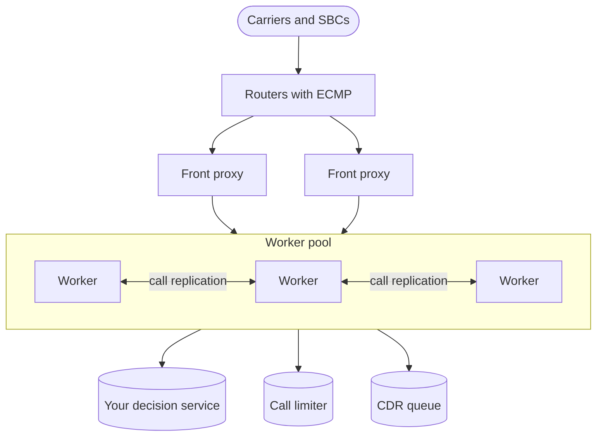

# siprustserver

A SIP application platform in Rust. It gives you a complete B2BUA call engine, built and tested
to production standards, with high availability and overload protection as part of the
platform. You supply the routing backend and your services. Two services are built in, and one
sample service shows how to write your own.

The model is that of a telecom application server, such as a JAIN SLEE container. A pool of
call workers runs behind two stateless front proxies. When a worker dies in the middle of a
call, a different worker continues the call.

| Part | Status |
|---|---|
| Call engine: the default B2BUA | Built and tested to production standards. It has not yet carried production traffic. |
| Front proxy, call limiter, route guard | The same, and they ship as production binaries. |
| Built-in services: blind transfer, first 18x handling | Part of the call engine, under the same checks. |
| Sample service: announcement | A model for your own services. |
| Reference worker | For evaluation and load tests. A production worker is your own binary, with your routing. |



## What you get

### Calls that continue when a worker is lost

- Each call has a primary worker and a backup worker. The primary replicates the call to the
  backup before its messages leave.
- If the backup confirms in 100 ms, the call continues after the loss of one worker. The
  parties see retransmissions. A ringing tone sent without RFC 3262 can be lost.
- If it does not, the platform still has a defined behaviour. The call continues, or it ends
  as RFC 3261 permits, or its dialogs are left to the timers of the endpoints. No call stays
  in the platform with no owner.
- A planned stop, such as a rolling update, hands the calls to their backups with no effect on
  the parties.
- 1 488 failover cases prove the Guaranteed tier: 15 call flows, cut at each step, by each kind
  of worker loss.

Read [High availability: guarantees and constraints](docs/guide/ha.md).

### Overload protection with stated limits

- A worker refuses new calls before it runs out of memory or CPU, at ceilings that you set. The
  refusal is a 503 with a `Retry-After` that spreads the callers.
- Calls in progress continue under overload. No limit refuses the teardown of a call.
- Emergency calls pass the load checks and have their own, higher ceilings.
- A caller that got 100 Trying gets a final response from a live worker. On an internal
  failure, it is a 503 in 5 s.
- Each call has a bound on its messages, legs and timers. One call cannot take a worker.

Read [Overload protection](docs/guide/overload.md).

### Call logic that you extend

- A decision engine, one Rust trait, routes each call and selects the next target when a
  route fails.
- A service is a state machine that adds steps to a call: an announcement, a transfer, a
  change to early media. Two services are built in, and one sample shows how to write your
  own.
- A handler of a service is a function from an event to a list of actions. Timers end with
  the leg or the service they guard, so a service has no code for an old timer.
- A service needs no HA code. Its state is in the call record, and the platform replicates
  the record.
- The call engine handles INVITE, UPDATE, PRACK, REFER, INFO, forked calls and crossed
  requests.

Read [Call logic: how to extend it](docs/guide/services.md) and
[The service model](docs/guide/service-model.md).

### Rules that tools check

- The code that reads the network cannot panic on its input. 30 of the 34 production crates
  have no site that can panic, and a count holds the other 4.
- The call logic is pure: no clock, no socket, no shared state. The same events give the same
  call on each node.
- Each loop has a bound. The code has no `unsafe`, except in 4 named crates.
- About 9 200 tests. Each test of a call ends with an audit of 95 RFC rules and a check that
  the engine released the call.
- 15 fuzz targets run on the parser, the call logic, the proxy and the replication.

Read [Engineering rules of the critical code](docs/guide/engineering-rules.md).

## High availability in brief

| If | Then, when one worker is lost |
|---|---|
| The backup confirmed each change of the call in 100 ms | The call continues. The parties see retransmissions. Three limits apply. A ringing tone sent without RFC 3262 can be lost. A lost answer comes on the retransmission of its request. A backend can get one request two times. |
| The backup was slow, behind, or cut off | The call continues, or the platform ends it with a BYE on each side, or its dialogs are left to the timers of the endpoints. The call gets one or two CDRs. |
| The call had no backup, or its two workers are lost together | The call is lost. The endpoints end it with their own timers. |

Two pages are required reading before a deployment:

- [High availability: guarantees and constraints](docs/guide/ha.md) states each condition, how
  the platform degrades, what it does not cover and what your site must provide.
- [Front proxy: how to integrate it](docs/guide/proxy-integration.md) gives the recommended
  network design. BGP announces two virtual addresses, and your routers share the traffic with
  ECMP. BFD and a route guard remove a dead or sick proxy in less than 3.4 s. The page lists
  the two failures that take longer.

## Components

| Component | Binary or crate | Role |
|---|---|---|
| Front proxy | `sip-proxy-runner` | Stateless SIP proxy. It selects the two workers of a call and routes each message by a signed cookie. |
| Route guard | `route-guard` | Runs beside a proxy. It removes the node from the routers when the proxy is unfit. |
| Worker | Your binary, on `b2bua-runner-kit` | The B2BUA. It serves calls and keeps the copies of its peers. |
| Reference worker | `b2bua-runner` | A worker with a fixed destination, to evaluate the platform and to run load tests. |
| Call limiter | `call-limiter-runner` | Counts calls for each key that a routing decision names, across all workers. |
| CDR consumer | `cdr-consumer-runner` | Reads the CDR queue and exposes counters. |
| Helm chart | `deploy/helm/siprust` | Deploys the above on Kubernetes and checks the settings as one set. |

## Limits

- **UDP only.** No TCP and no TLS for SIP. Each SIP peer must be on a path that carries IP
  fragments.
- **Signalling only.** The worker relays no RTP.
- **No digest authentication, no REGISTER, no attended transfer.**
- **IPv4 on the proxy path.**
- **Kubernetes is the only deployment that ships.** The binaries run outside it, but the
  announcement of the addresses is then your own work.
- **The reference worker has no HTTP decision client.** A production worker needs a decision
  engine, written in Rust against `b2bua-decision`.
- **Version 0.1.** The settings, the replication format and the Rust interfaces can change
  between versions.

## Quick start

This runs the reference worker on one host and sends calls through it.

You need Linux, the stable Rust toolchain, `mold`, `make` and a C compiler.

```bash
cargo build --release -p b2bua-runner -p loadgen

# Terminal 1: one worker, no proxy, no replication. It sends each call to 127.0.0.1:6001.
B2BUA_MODE=standalone \
B2BUA_LISTEN=127.0.0.1:5080 B2BUA_ADVERTISE=127.0.0.1:5080 \
B2BUA_DEST=127.0.0.1:6001 \
  target/release/b2bua-runner

# Terminal 2: 10 calls a second for 30 s. The caller is on port 6000, the callee on 6001.
target/release/loadgen --target 127.0.0.1:5080 --bind-ip 127.0.0.1 --base-port 6000 \
  --correlate to-user --scenario basic_call=1 --cps 10 --duration 30 \
  --out-dir ./loadgen-report
```

Open `loadgen-report/index.html` for the result and a sequence diagram of the calls. The worker
serves its metrics on `http://127.0.0.1:9091/metrics`.

For the full platform, with two proxies, three workers, replication and incident tests, use
the lab cluster in [deploy/README.md](deploy/README.md).

To build a worker with your own routing, start at
[The worker binary](docs/guide/services.md#the-worker-binary).

## Tooling

The repository has the tools we use to test the platform. They work on any SIP system.

### sipflow: calls from a capture

`sipflow` reads a pcap or pcapng file, plain or gzip. It parses each datagram with the parser of
the platform and joins the legs of a B2BUA call into one call. It prints each call as a ladder.
It can also review the calls against the 95 RFC rules of the test audit. For each finding, it
states which side sent the message.

```bash
cargo build --release -p sip-pcap --bin sipflow
target/release/sipflow capture.pcap --list                    # one line for each call
target/release/sipflow capture.pcap --call-id 7f3a --full     # the ladders, with the messages
target/release/sipflow capture.pcap --sut 10.0.0.9 --rfc      # the RFC review
target/release/sipflow capture.pcap --json > calls.json       # the full model
```

It reads UDP only, and it does not capture. See [docs/sipflow.md](docs/sipflow.md).

### pcap-anon: a capture you can share

`pcap-anon` rewrites the flows document that `sipflow --json` writes, so that a capture can leave
the network it was taken on. Every number, name, host and address becomes a fake. A seed, drawn
on the first run and kept in a file, gives each identity the same fake everywhere, and the same
output byte for byte on the next run. With `--verify` it searches the output for what the raw document
held, and writes nothing if it finds any. `sipflow --to-pcap` turns the result back into a capture.

```bash
cargo build --release -p sip-pcap --bin sipflow
cargo build --release -p pcap-anon
target/release/sipflow --json --reading my.reading capture.pcapng > capture.flows.json
target/release/pcap-anon anonymize capture.flows.json capture.anon.flows.json \
  --plan my.plan.json --reading my.reading --profile my.profile.json \
  --seed-file capture.seed --fresh-seed --verify
target/release/sipflow --to-pcap capture.anon.flows.json --out capture.anon.pcap
```

You write the numbering plan, the network profile and the reading for your network. A few
identities stay readable, such as a name a peer typed into a reason phrase, and the crate README
lists them. See [crates/pcap-anon/README.md](crates/pcap-anon/README.md).

### loadgen: a load generator

`loadgen` sends SIP calls at a controlled rate and plays the caller and the callee. Use it where
you use SIPp today, when you accept a lower top rate for less work: one process, one JSON
profile, a rate you change over HTTP, and a report with the sequence diagram of each kind of
failure.

| | SIPp | loadgen |
|---|---|---|
| Call flows | One XML file for each call flow | 20 call flows ship: basic call, re-INVITE, forked call, PRACK and UPDATE, REFER, CANCEL, rejects, emergency calls. A new call flow is Rust code. |
| A run | Command line options | One JSON profile: the mix of call flows, the rate, the durations, the packet loss |
| Rate control | Keys in the terminal, or a control socket | HTTP: read the rate, change it, drain the run |
| Result | Counters and CSV files | An HTML report with a sequence diagram of sampled calls for each result class, Prometheus metrics, one JSON record for each call |
| Checks | The messages that the XML expects | A result class for each call. The RFC audit and field checks on sampled calls. |
| Transports | UDP, TCP, TLS, SCTP | UDP |
| Authentication, REGISTER, RTP | Yes | No |
| Top rate | Higher | Its help text sizes one worker thread for 400 to 500 calls a second. No measured figure yet. |

```bash
target/release/loadgen --target <ip:port> --bind-ip <local ip> \
  --scenario basic_call=4 --scenario reinvite=2 --scenario refer=1 \
  --cps 50 --duration 60
```

See [crates/loadgen/README.md](crates/loadgen/README.md).

### hakit: incidents under load

`hakit` runs a load on the lab cluster and injects incidents on a schedule. 29 incidents ship,
such as a worker kill, a node stop, a network partition, packet loss, a clock change and a load
spike. It charges each failed call to the incident that caused it and compares the total with a
budget. A failed call that no incident explains fails the run.

```bash
cd tooling/hakit
uv run --locked hakit run kill-worker-smoke
```

It needs the lab cluster of [deploy/README.md](deploy/README.md).

### Other tools

- **Fuzzing.** `just fuzz <target>` runs one of the 15 fuzz targets. See
  [docs/testing/fuzzing.md](docs/testing/fuzzing.md).
- **Dashboards.** 11 Grafana dashboards for the workers, the proxies, the limiter, overload
  and failures are in `tooling/hakit/content/dashboards/`. [deploy/observability/](deploy/observability/)
  has a metrics, logs and traces stack to run them.
- **Capture replay.** `ts/` holds a tool chain that turns captures into replayable test cases
  and compares runs on a web site. It needs a product pack to be useful. See
  [ts/README.md](ts/README.md).

## Measured results

An endurance run of 3 hours with incidents is in progress. Its numbers go in
[docs/guide/results.md](docs/guide/results.md). That page gives the load and the impact of each
incident against its budget. It also gives the share of replication round trips inside the sync
cap, and the CPU and memory use.

## Documentation

| For | Read |
|---|---|
| The HA guarantee and its conditions | [docs/guide/ha.md](docs/guide/ha.md) |
| The network design of the front proxy | [docs/guide/proxy-integration.md](docs/guide/proxy-integration.md) |
| Overload behaviour and sizing | [docs/guide/overload.md](docs/guide/overload.md) |
| Your own routing and services | [docs/guide/services.md](docs/guide/services.md) |
| How to write a service: events, state machine, timers | [docs/guide/service-model.md](docs/guide/service-model.md) |
| How the code is kept correct | [docs/guide/engineering-rules.md](docs/guide/engineering-rules.md) |
| Each setting, its relations and its effect | [docs/TUNING.md](docs/TUNING.md) |
| Deployment and the lab cluster | [deploy/README.md](deploy/README.md) |
| Logs, traces and sampling | [docs/observability.md](docs/observability.md) |
| The reason for each design decision | [docs/adr/](docs/adr/) |
| The vocabulary | [CONTEXT.md](CONTEXT.md) |
| Rules for a contribution | [CLAUDE.md](CLAUDE.md), [docs/testing/](docs/testing/) |

## Licence

MIT. See [LICENSE](LICENSE).
