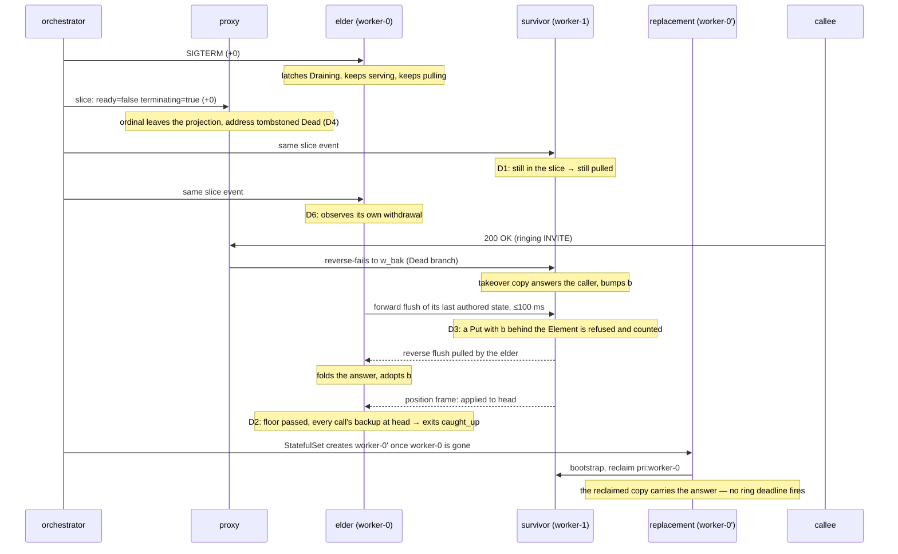
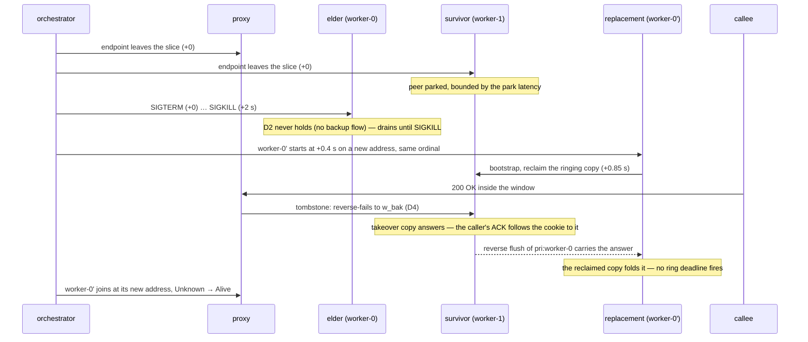
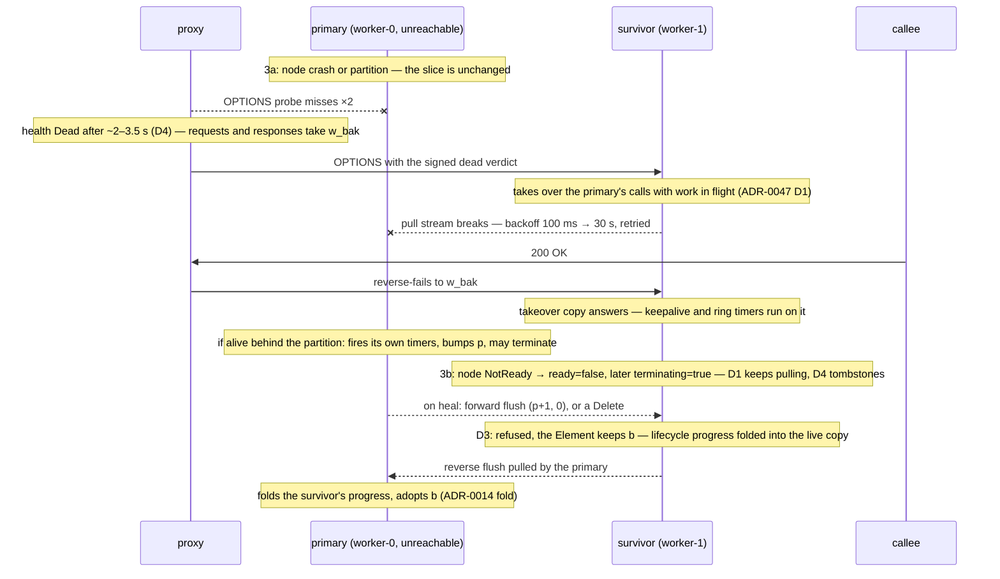

# 0031 — A worker's ways out: graceful, abrupt, vanished, restarted in place — one membership rule for a member still in the slice, one guard for the forward flush

**Status:** accepted (2026-09-13). Amended (2026-10-12): the case table, leaving the slice takes over
the worker's calls with an INVITE in flight (ADR-0047). Amended (2026-10-16): D4, the proxy's
`Draining` grace is removed; Draining reports `new=refuse` on an OPTIONS `200` (ADR-0050).
Amended (2026-10-23): D2, D4 and the per-axis fold, replaced by containment and one
routing rule (ADR-0055 §3, §7, §8). Amended (2026-10-28): case 3a, the proxy tells its
dead verdict to the workers and the backups take over the calls with work in flight at
it (ADR-0050 §3, ADR-0047 D1).

**Source:** this codebase. Triggered by the failover-harness scenario
`crates/failover-harness/tests/it/withdrawn_primary_answers_in_its_window.rs` and its views
ledger, which showed that the *graceful* exit — the most frequent one — opens the same
unreplicated window as a forced kill, for its whole drain grace. Amends ADR-0012 D4
(what membership deletion means) and ADR-0014 §3 (the forward apply rule) and §12 (the
removed `Ack` frame). The proxy's departed-address tombstone
(`crates/sip-proxy/src/registry/tombstone.rs`) is the routing half this ADR builds on.

## Context

A worker leaves a cluster's service in four ways, and every HA mechanism in this codebase
was designed against only the second one. The endpoint conditions are those of the
EndpointSlice API (`ready`, `serving`, `terminating`; the last two GA since Kubernetes
1.26; an absent `serving` defers to `ready`, an absent `terminating` means false).

| | how the pod goes | what the slice shows | how long the process still runs | who replaces it |
|---|---|---|---|---|
| **1. Graceful** (rolling update, node drain, scale-down; the frequent case) | `delete` under the pod's `terminationGracePeriodSeconds` (30 s); SIGTERM at +0 | `ready=false, terminating=true` at +0 and the endpoint **stays in the slice** until the pod is gone; `serving` flips false a few seconds later, because the worker's own `/ready` answers 503 once it latches `Draining` | until it exits on its own (drain, ≤ `B2BUA_DRAIN_GRACE_MS` = 5 s, then the limiter release flush, ≤ 3 s, then the CDR sink's close, ≤ `B2BUA_DRAIN_CDR_FLUSH_MS` = 3 s) or SIGKILL at the grace | the same ordinal, **after** the old pod is gone (a StatefulSet never runs two pods of one ordinal) |
| **2. Abrupt** (`delete --force --grace-period=0`) | the API object is removed at +0; kubelet still sends SIGTERM and SIGKILLs 2 s later | the endpoint **leaves the slice** at +0 (one `terminating=true` event may precede the removal) | 2 s | the same ordinal at a **new address** from +0.4 s, overlapping the old process |
| **3. Vanished** (node crash, network partition) | 3a, the first ~40 s: nothing, the pod object is untouched. 3b: the node controller marks the node NotReady, its pods `Ready=False`; taint eviction (~5 min) stamps a deletion timestamp; with the kubelet unreachable the pod can stay `Terminating` indefinitely | 3a: **unchanged**, `ready=true`. 3b: `ready=false, serving=false`, then `terminating=true`, still in the slice | unknown: dead, or alive behind a partition and still firing its timers | nobody for minutes; on a heal, the **same process** is back |
| **4. Restarted in place** (OOM-kill, kubelet restart, a readiness flap under load) | the pod object stays; the container restarts, or only the probe fails | `ready=false, serving=false, terminating=false`, still in the slice, **same address** | 0 (container restart) or the whole time (readiness flap: the process is alive and serving) | the same container, same address, seconds later |

Leaving the slice is also when a worker's backups take over its calls with an INVITE
in flight (ADR-0047): at the end of case 1, the pod gone after its drain; at +0 in
case 2, overlapping the process's last 2 s; and in case 3b when the pod on an
unreachable node is force-deleted, while its process may still live behind the
partition. Case 3a and case 4 never leave the slice. In case 3a the proxy's probe reads
the worker dead and tells the workers that verdict: the backups take over the calls
with work in flight at once, an undecided call's decision asked again, and the
force-delete of case 3b discharges what is left (ADR-0047 D1, D2, D4). Case 4 is read by the tombstone and stays reactive.

What each element believed about the leaving worker, per case, from the harness's views
ledger and the kind cluster's logs:

- **The proxy** learns of cases 1, 2 and 4 from membership (the ordinal leaves the
  projection when `ready` drops) and of case 3a from its OPTIONS probe only (`Dead` after two
  missed windows, ~2–3.5 s). Its request path fails an absent or `Dead` primary over to the
  cookie's `w_bak`; its response path does so for an INVITE response from a `Dead` worker
  and, since the tombstone, from a departed address.
- **The peers** learn of cases 1, 2 and 4 from membership and **park** the ordinal: pullers
  cancelled, watermark kept. The informer today emits only `ready` endpoints, so leaving the
  routable set and leaving the membership set are one event. Replication is pull-only, so
  from that instant nothing the worker authors reaches anyone. In case 3a they keep the
  peer, lose the TCP stream, back off (100 ms → 30 s) and retry.
- **The leaving worker itself** learns nothing from membership: a node filters its own
  ordinal out of its desired peer set and never observes its own withdrawal. SIGTERM is the
  only signal it has. On SIGTERM it latches `Draining` (OPTIONS 503, `/ready` 503), keeps
  serving, and waits for its live calls to clear or the grace to elapse. It keeps pulling
  its peers throughout, so it still folds their progress on its own calls.

The drain was designed as "keep serving in-flight transactions and have the time to flush
the call context to the backup". The second half never happened: the peers park the worker
the instant its endpoint drops, which in case 1 is the same instant SIGTERM arrives. The
drain then serves for 5 s into a void — and, since the tombstone routes everything around a
withdrawn address, it does not even receive the traffic it was kept alive for. Whatever it
authors in those seconds (a relayed 2xx, a cancelled ring timer, a terminal state) exists on
one node only. At the route-time ring deadline the reclaimed copy on the replacement, or the
takeover copy on the survivor, authors a second final onto an INVITE the caller already
ACKed (RFC 3261 §17.2.1, §13.3.1.4). The scenario reproduces this identically for the
graceful and the abrupt case. Case 4's readiness flap is the same defect without a
restart: a live, serving worker is parked by its peers for the length of the flap.

Case 3 has the mirror hazard. A partitioned primary keeps its calls, fires its own timers
and bumps `p` on them. When the partition heals, its **forward** flush of the `bak:`
partition is applied by the survivor unless the stored Element strictly dominates it — and
`(p+1, 0)` is never dominated by `(p, 1)`; a forward `Delete` is applied unconditionally.
The survivor's Element regresses to the primary's view, or is wiped, while its live takeover
copy is untouched; if the survivor later self-releases and re-takes over, it materialises
the regressed Element and fires a ring timer on a call it answered itself, or finds nothing
to materialise. Today the park in cases 1, 2 and 4 hides the same hazard; keeping the peers
pulling a draining worker would expose it.

## Decision

Six rules, each stated with the case it serves and the cases it must not harm. The ADR
assumes at least two workers; with one, D1 and D2 have no peer and degrade to today's
quiescence-or-grace.

**D1 — A member still in the slice stays a replication peer; only a `ready` member is a
routing target.** The informer emits every endpoint in the slice as a `Peer` carrying
`ready` and `terminating`; a condition flip is a delta, never a host move: a `terminating`
flip on a ready member must not reset the proxy's health or re-arm its fresh-pod guard, while a
`ready` flip departs the member at the proxy and a return rejoins it as a fresh endpoint. *Pullable* is "present in the slice", whatever its
conditions: the supervisor pulls it like a ready peer until it leaves the slice. *Routable*
is `ready`: the proxy's `WorkerSet::recompose` filters the snapshot at the projection, so a
`ready=false` member departs exactly as today — the ordinal leaves the projection and its
address is tombstoned — and the response-path failover is unchanged. Pullable is keyed
on presence, not on `serving`: the draining worker's own `/ready` 503 drives
`serving=false` within seconds of SIGTERM, long before its drain ends.
Serves case 1 (the peers ingest what the draining worker authors within one 100 ms poll
tick) and case 4 (a readiness flap no longer parks replication). Case 2 presents at most one
`terminating` event before the removal: harmless. Case 3b keeps pulling a member that is
unreachable, and may do so indefinitely for a pod stuck `Terminating`: the same backoff as
3a today, and D3 guards the heal. A member that is only pullable is not a backup target: a
`w_bak` cookie minted on it resolves to nothing until the replacement joins, as today; in a
two-worker cluster the survivor's calls have no failover for that window (the fresh-pod
guard covers the replacement's first seconds). (Amends ADR-0012 D4: membership deletion no
longer means "gone" for both consumers at once.)

**D2 — The drain of a withdrawn worker exits when its backups hold its calls.** Three
preconditions, all required: (i) the worker has observed its own withdrawal (D6), so
nothing new can be routed to it; (ii) a floor, `B2BUA_DRAIN_MIN_MS` (default 1000 ms), has
elapsed since SIGTERM, so an INVITE the proxy routed before the slice update is still
served; (iii) for **every live call** this worker serves, the Backup flow from the peer the
call names as its backup (`topology.bak`) is connected and has **applied** this worker's
changelog head. "Applied" is reported by the puller in a new position frame (the drain's
own signal, never a takeover or readiness gate — the role ADR-0014 §12 retired `Ack`
from); the puller answers every idle `Noop` with one, so a report older than two `Noop`
intervals is unknown, never current. A call whose backup flow is absent or behind keeps the
drain waiting; the grace (5 s) stays the ceiling and live calls clearing stays an exit. The
exit reason is counted (`quiescent`, `caught_up`, `grace_peers_behind`): the last one is
"a flush window was lost" and must be visible. A worker that is not withdrawn (direct-bound,
static membership, or SIGTERM before the slice moved) keeps quiescence-or-grace: takeover is
reactive, so a proxied worker's calls are served on the next in-dialog request, but a
direct-bound worker's would be abandoned. Exiting on `caught_up` with live calls is a
*replicated crash*, deliberately: once the endpoint leaves the slice its backups take
over the calls with an INVITE in flight (ADR-0047), the quiet ones on their next request. Before any exit the worker flushes its queued limiter
releases within `B2BUA_DRAIN_RELEASE_FLUSH_MS` (3 s, ADR-0040 decision 9); an exit is
taken only with the queue empty, and a quiescent or caught-up one only if it still holds
once the flush is done, since the worker serves its calls meanwhile; the drain never
outlasts the grace plus the flush.
Serves case 1. Case 2 runs the same drain for its 2 s: the
peers have parked, (iii) never holds, SIGKILL ends it. Cases 3 and 4 run no drain.

**D3 — A forward flush never regresses backup progress.** This rule changes the
**Forward** direction only — the Backup flow after bootstrap — and therefore requires the
puller's `ForwardOrBootstrap` mode to split into `Forward` and `Bootstrap`; bootstrap keeps
ADR-0014 §3's "take the replica's `(p,b)` as-is". In Forward: a `Put` `(p', b')` is refused
when the stored Element carries `b > b'`; a `Delete` is refused when the Element carries
`b > 0` and its body is not terminal (delete-wins stays for everything else). Both are
counted. (Both rules as amended below.) A refused body is folded only where a live copy
exists: if this node holds a live
takeover copy of the call, the body is handed to the live fold (unanswered < caller
answered < terminating < terminated, ADR-0014's rule); an Element alone is kept as it is,
its merge deferred to the next materialisation. After a refusal the vector is split
(`(p+k, 0)` against `(p, b)`) and only lifecycle progress crosses it in either direction;
when the primary folds the backup's reverse flush it **adopts the Element's `b`**, so its
next forward flush is accepted and the split heals. Serves case 3 (the heal) and case 1
under D1 (the draining worker's last flushes); in case 2 it is active for the park latency
only. Residual, unchanged from ADR-0014's dual-owner window: a partitioned primary that
terminated a call the survivor kept serving has already written its CDR; the survivor
writes its own (residual as amended below). (Amends ADR-0014 §3.)

**D4 — Routing around a leaving worker has two signals, one branch.** Membership
(cases 1, 2 and 4: the address is tombstoned `Dead`) and the OPTIONS probe (case 3a: `Dead`
after the miss threshold) both land on the same `Dead` health, and the request and response
paths already take the backup on it. The probe's verdict is also told to the other workers,
signed (ADR-0050 §3), so the backups take over at once what the proxy now routes to them,
once their replication stream from the worker confirms it (ADR-0047 D1);
the tombstone's is not, as a draining worker still serves its calls. The response path takes the backup for
**INVITE responses only**: a non-INVITE response answers a client transaction
only its sender holds (RFC 3261 §17.1.2), so it follows the Via to its sender
whatever that sender's health. A dialog-creating request a leaving worker sends after
its address is tombstoned is Record-Routed with the cookie it would have carried a moment
earlier: `w_pri` the ordinal the tombstone names, `w_bak` the rendezvous winner among the
other `Alive` workers (`strategies/load_balancer.rs`). The proxy also puts that cookie on
the Via it pushes on a worker's INVITE (`core/request/via_cookie.rs`); the INVITE's
CANCEL and non-2xx ACK carry the INVITE's Via, cookie included, from its memo, and a
retransmission repeats its first copy's cookie on the Record-Route and the Via. So the
cookie, not the tombstone's window, carries the dialog: an INVITE response whose
sender's address names neither of the cookie's workers — nobody, past the window, or a
worker that took the address since — goes to the cookie's worker at the address it
holds now, else to `w_bak`, else nowhere; a response to the cookie's backup, a
takeover copy's, follows the Via to it; a stranger's request carries no such Via and
its response follows the Via. Its in-dialog requests resolve by ordinal for the
dialog's life; an address neither live nor tombstoned gets no cookie
(`core/departed_originator_tests.rs`; `core/response/via_cookie_tests.rs`;
`outbound_invite_after_the_departure.rs`).
The tombstone is **re-armed by every response the
proxy sees for that address** (its next Via's sent-by names it, whatever the method),
so it lives Timer H past the last sign of life, whatever
the drain grace is set to; a fixed TTL from departure would expire under a live elder
whose grace was raised. A worker rejoining at the address clears the tombstone; a
non-worker reusing it stays tombstoned while responses for it keep coming. The proxy's `Draining` grace (in-dialog traffic sticks to a draining
primary for 5 s) is recorded as effectively unreachable under Kubernetes: a probe tick can
stamp it inside the withdrawal window, but the ordinal leaves the projection first in
practice. It stays for a static worker pool.

**D5 — The leaving worker keeps serving what still reaches it, and stands down only
through the drain.** No "stop authoring on SIGTERM": a proxied worker receives nothing after
withdrawal, a direct-bound one must finish what it holds. What protects the caller from a
second, *different* final is the fold: the primary pulls the survivor's reverse flush and
inherits its obligations (D3 keeps the fold's inputs honest). A duplicate 2xx it re-emits
from the survivor's retained datagram is tag-identical and merely harmless. Convergence is
by folding, never by a primary going passive; the acting-backup self-release stays scoped
to takeover copies (ADR-0014). The SIGTERM-versus-informer race (tens of milliseconds
either way) is benign because of D1: an INVITE served in it is replicated. A withdrawal
the worker observes with no SIGTERM following (D6: the endpoint gone without a kill, or a
pod stuck `Terminating` behind a dead kubelet) runs the same D2 drain, and the process
exits; the orchestrator restarts the ordinal. A worker never stays `Draining` while it runs.

**D6 — A worker observes its own endpoint.** The worker already runs the informer; one
predicate on its own `targetRef.name` tells it it is withdrawn (`terminating` and not
`ready`, or absent — a not-ready endpoint that is not terminating is a readiness flap),
once it has seen its own endpoint `ready`: a pod not ready yet is not withdrawn.
On that signal it latches `Draining` even if SIGTERM is late (a preStop hook, a stuck
kubelet), and it is the precondition D2 needs to know that nothing new will arrive. A
worker on a static membership never observes itself and keeps today's behaviour. This
does not make the worker stop serving (D5); it makes it know what the proxy knows, and
drain then exit as on SIGTERM.

## The cases after this decision

### Case 1 — graceful

Design change here: D1, D2, D3, D6. The other cases never satisfy D2's preconditions and
present D1 only as described below.

### Case 2 — abrupt

Design change here: none beyond the tombstone already landed. What the elder authors in its
2 s is lost, bounded by the tombstone to what it does on its own (timers), never to a
message the callee sent. Accepted residual; the harness's abrupt case pins that the caller
is answered once.

### Case 3 — vanished

Design change here: D3, and D1's presence rule in 3b. D2 and D6 never engage before the
eviction. The dual-owner window while the partition lasts is ADR-0014's accepted trade-off,
unchanged.

### Case 4 — restarted in place

No diagram: `ready` drops with the endpoint still in the slice at the same address. The
proxy departs it and tombstones the address; a join at the same address clears the
tombstone and the entry is `Unknown` until probed, as today. Under D1 the peers keep
pulling: a readiness flap pulls a live worker (the fix), a container restart pulls a fresh
incarnation once it listens again (the same reconnect as today's reboot).

## Why the frequent case does not tax the others

| mechanism | 1 graceful | 2 abrupt | 3 vanished | 4 in place |
|---|---|---|---|---|
| D1 pull every member in the slice | active | one event at most | 3b: keeps pulling an unreachable member | active |
| D2 caught-up drain exit | active | never holds: SIGKILL ends the drain | no drain | no drain |
| D3 forward-flush guard | active on the last flushes | active for the park latency | **active on the heal** | inert |
| D4 tombstone / probe `Dead` | tombstone, re-armed on sight | tombstone | probe, then tombstone in 3b | tombstone |
| D5 keep serving, stand down only by the drain | drain finishes what reaches it | 2 s into a void | timers only | unchanged |
| D6 self-observation | active | active (the endpoint is absent) | 3b only | inert (a flap is no withdrawal) |

D3 is the one rule every case shares, and it is a refusal, not a new flow. D2 is the one
rule that could cut a drain short, and its three preconditions make it inert wherever the
peers do not hold the calls.

## Consequences

- `topology::Peer` carries `ready` and `terminating`; `peers_from_slices` emits every
  endpoint in the slice; `SimulatedMembership` can set the flags, so the failover harness
  expresses case 1 as "withdraw from routing, keep the peers pulling", case 2 as "withdraw
  from both", and case 4 as "not ready, same address".
- The proxy's `WorkerSet::recompose` filters `ready` at the projection; departure and
  tombstoning are unchanged. The tombstone re-arms on every response seen from its address.
- The puller sends a position frame after applying a batch; `drain_until_quiescent` takes
  the D2 predicate, the floor and the withdrawal precondition; the exit reason is a counter,
  time-in-drain a histogram, pulled-not-ready peers a gauge, refused forward flushes a
  counter beside the reverse one.
- The reason set is four: a non-withdrawn worker reaching the ceiling is `grace`, distinct
  from a withdrawn one's `grace_peers_behind`.
- `ApplyMode::ForwardOrBootstrap` splits; the Forward mode refuses a backup regression on
  `Put` and on `Delete`; the primary's fold adopts `b`.
- The worker's supervisor evaluates its own endpoint (D6).
- Harness cases: terminating-but-pulled (1), the abrupt case unchanged (2), partition then
  heal with a Put and with a Delete (3), readiness flap without park (4), drain exits
  `caught_up` inside the grace, drain waits with a backup behind, forward refusal unit at
  the puller.
- CONTEXT.md gains **withdrawal**, **terminating member**, **departed-address tombstone**;
  the K8sMembership entry names the two predicates; the readiness entry names the drain's
  exits.
- Out of scope: a push-based flush (replication stays pull-only, ADR-0011); stopping a
  worker from authoring (D5).

## Amendment — progress is a chain, and every refusal moves the counter

**Lifecycle progress is a chain, not a rank.** A refused flush folds into a live copy only
when it made every step that copy made and at least one more, on both monotone axes:
*answered* (unanswered < the caller was answered) and *ending* (active < terminating <
terminated). A terminal body whose caller was never answered, reaching a live copy whose
caller **is** answered, is a pre-answer teardown on a view its owner left behind — a branch,
not progress — and is refused in both directions. "Answered" is read from the final the
a-leg's initial INVITE server transaction took (`call::helpers::caller_answered`), which is
durable: it stays true once the leg is `Terminated`, where `LegState::Confirmed` does not.

**A re-INVITE round is a third chain, one per dialog.** A round is the INVITE client
transaction one dialog relays toward its peer (`call::helpers::round`), ordered on its
dialog by the CSeq it went out with (`InviteTxnHandle::cseq`): *open* while its relay
awaits a final, then *answered* (a 2xx taken, the originator's ACK awaited) and *ACKed*, or
ended by a non-2xx; it never goes back. Its final reaches the node holding the client
transaction, so a round's end the other copy saw is progress a record holding the round
unfinished cannot make itself. A body stands further along a round the live copy holds open
when its same dialog no longer holds the relay at the round's CSeq and holds the same
transaction (it took the 2xx), a later one (a next round began), or none and a sequence at
or past the round's (a non-2xx ended it, which leaves no transaction); further along an
answered round when it no longer awaits that 2xx's ACK and either its ACK left or a later
transaction stands on the dialog. **A round's opening is progress too**: the copy that
relayed the request holds the client transaction, and only it sees the final. A body opened
a round the live copy never reached when its dialog holds an INVITE client transaction and
the live copy's same dialog holds neither that transaction nor a later one, nor — holding
none — a sequence at or past its CSeq; whatever stage the body holds it at. Round presence
is read from the transactions, never from a dialog's sequence alone, which both copies raise
(below). Rounds are read dialog by dialog: a round a body stands ahead on is progress
whatever the live copy holds on another dialog, and the fold takes that dialog's round alone,
the live copy's rounds on other dialogs staying. A step on the answer or ending axis folds
whole whatever round the live copy holds: a call not yet answered holds no re-INVITE round,
and only the node holding a round's client transaction sees its final, so an ending folded
into the primary's record gives every re-INVITE this node relayed and holds open one final for
its originator: one the ending body holds CANCELled was answered by the other copy's
teardown, and this node relinquishes its server transaction with nothing sent; any other
it answers as its own teardown does — a 487 to its originator, a CANCEL to its target (RFC
3261 §15.1.2) — and the call is discharged (`ending_crossing_a_round.rs`). The fold and the
order the gates read (`lifecycle_behind`, the round ranked after the answer and the ending)
read the same rule (`call/tests/it/lifecycle.rs`:
`an_ending_is_progress_whatever_round_the_record_holds`,
`a_round_ended_in_the_other_copy_advances_the_record_holding_it_open`,
`an_acked_round_advances_the_record_awaiting_its_ack`,
`a_round_the_other_copy_opened_advances_a_record_that_never_reached_it`,
`a_sequence_raised_past_a_round_does_not_reach_it`,
`crossed_rounds_fold_each_on_its_own_dialog`,
`rounds_opened_on_both_dialogs_crossed_are_each_progress_on_its_dialog`;
`crossed_reinvite_round.rs`: the refused, the next-round and the answered-then-next-round
cells; `round_the_primary_never_read.rs`, the round crossing the primary's own round).

**A round's end folds alone, and so does its opening.** The answer and the ending start or
end the call, and a body further along on either folds whole. A body whose only progress is
a round's end or opening folds only that round's facts into the live copy
(`call::helpers::merge_rounds`): on the round's dialog
its INVITE relays, its INVITE client transaction, the ACK state of that transaction's 2xx,
the offer it owes an answer to and the higher of the two sequences; on the originator's
dialog the 2xx it awaits an ACK for, that 2xx's ladder timers and the higher remote
sequence; and the session state of both legs when the body opened at least as many
offer/answer exchanges on each of them, so an exchange count is never lowered nor a
description sent replaced by an earlier one (RFC 3264 §8). On this path what the live copy
relayed on its own since the other owner branched, and the sequence it advanced, stay
(RFC 3261 §12.2.1.1; `crossed_reinvite_round.rs`, the two answered cells;
`call/tests/it/round.rs`). An answered round folded into the record has its Accepted
server INVITE seeded there; an open one keeps its transactions at the node that relayed
it (ADR-0014, "a fold into the call's record seeds the answered INVITEs it brings";
`retained_2xx_folded_into_the_record.rs`).

**A fold adopts both counters, and so does a refusal.** A fold takes `max(p)` and `max(b)`
of the two views and is not a write of this node: neither axis moves and nothing flushes,
and the store keeps the version this node last flushed (ADR-0014, "a fold is not an
increment", for what the live copy holds on each path). A *refusal* takes only the axis the
other owner bumps — `b` at a primary, `p` at a backup — and takes it **without** the
authoritative bump an ordinary mutation makes: adopting a version another owner published is
a read this node records, and bumping our own axis for it would make two live owners raise
each other in turn, one flush per round. The adopted view is **flushed**, not only held in
the live map: an adoption that never reaches the store is lost when a takeover copy
self-releases, and this node's next flush then names a version its peer has long moved
past. Without any of this the split never closes: the refused owner keeps flushing behind the
Element's `b` and every later flush is refused in its turn.

**No fold or refusal lowers a dialog sequence.** Every request either owner relays or takes
moves a dialog's own or remote sequence, and the peer saw it. Every fold and every refusal,
at either node, takes the higher of both views' sequences on each dialog both hold
(`call::helpers::raise_sequences`), so this node's next request continues past every one the
other owner sent (RFC 3261 §12.2.1.1). Round presence never reads that sequence (above).
A fold brings facts into the primary's record and seeds no transaction there.

**An adopted counter is not the body it counts.** A backup's `p` may name a primary version
whose body it does not hold: it took that `p` from the primary's write it refused, or from a
fold of only the primary's rounds (`adopt_counters`). The body records it
(`CallTopology::gen_adopted`): set when a backup's `p` moves past the body's content, cleared
by the primary's own write and by every fold at the primary, whose body is the primary's.
One such mark means exactly "this body's `p` is not the version of the primary's body it
holds"; it orders nothing and counts nothing. The Reverse vector's verdict (`p` unchanged,
`b` advanced) folds a body whole only when it is unmarked and not behind the live copy
(`lifecycle_behind`); a marked body folds only through its progress — an answer or an
ending whole, a round's alone — so the vector clause never drops or brings back a write of
the primary's: a relay it holds or closed, an UPDATE it saw answered, a sequence it advanced
(`router/reclaim/tests.rs`:
`the_vector_clause_never_folds_a_body_whose_p_was_adopted`,
`a_refusal_raises_the_dialog_sequence_and_nothing_else`,
`a_round_fold_raises_the_records_sequence_on_every_dialog`,
`a_refusal_raises_the_sequence_past_a_round_it_never_reaches`;
`adopted_counter_reverse_fold.rs`, `split_dialog_sequence.rs`,
`round_the_primary_never_read.rs`, the round served whole at the copy).

**A split is a disagreement about the call, not a lag in the counters.** Two live owners of
one call run a flush apart for as long as both serve it, so `b_stored > b_in` alone cannot
tell an authority that is merely behind from one that is somewhere else. The body tells
them apart: while the vector is split (`b_stored > 0`), a forward `Put` whose body stands
BEHIND the Element is a **branch** of the call and is refused. Behind is read answer first
(ADR-0047 D7): an unanswered teardown never ends an answered call, so an answered body is
never behind an unanswered one, and between bodies alike on the answer the one less far
toward its end is behind. So the `Put` rule is "refuse a branch, and refuse a `b'` behind
the Element's `b`". One frame the stored vector dominates still applies: at the Element's
own `(p,b)`, over an Element an acting backup authored whose body is behind the frame's —
the authority refused that body, adopted its `b`, and republished its own call at that
version (ADR-0047 D7) — and over an Element whose `p` the acting backup adopted without the
authority's body, a frame not behind it: the authority's call at that version is its body,
the Element's only names it. So the Element a returning primary reboots from holds the
primary's record, not the copy's body lacking the primary's writes (`repl/puller/tests.rs`,
`the_authoritys_call_replaces_an_element_whose_p_was_adopted`;
`adopted_counter_reverse_fold.rs`, the UPDATE answered past the primary's reboot). The
Reverse gate refuses such a body likewise, so the primary's store keeps its own call and the
body rides up to the fold (`a_reverse_flush_on_an_adopted_p_never_replaces_our_call`).

**The `Delete` guard keys on the answer.** The one fact worth refusing delete-wins for is an
answer the authority never had: a forward `Delete` is refused exactly when the Element is
still there, its body is `Active`, its caller **was** answered, and the authority has never
published its own answer to it. Each of the other cases takes the delete. An ending Element
(`Terminating` or `Terminated`) goes with it: the call is over whoever ended it, and
whatever record is owed rides the reverse path. An expired Element has no call left to
protect. An authority that once flushed an answered body, or whose `Delete` states the
answer, is ending a call it knows about, however far behind its vector. A live takeover copy
beside the Element is **not** an escape either: it is ephemeral by construction and
self-releases the moment its transactions clear, so honouring a delete under it leaves the
answered call recorded nowhere. This paragraph and the one above supersede D3's `Put` and
`Delete` rules and its "folded only where a live copy exists" clause.

The authority publishes its answer by **flushing** it, taken or refused, **or by its
`Delete` stating it**. A refusal decides which body the Element keeps, never what its sender
saw — and two live owners of one call refuse each other's counters for as long as both serve
it, so an authority that answered through the reverse fold may land no further `Put`. The
changelog keeps one entry per call, so the last flush written within one drain of the delete
that follows it never leaves the node: the `Delete` is all the backup sees. The deleting
node therefore records on the delete's tombstone whether its own copy had answered the
caller when it removed it, and every `Delete` frame drained from that tombstone, tail or
cold, carries it (`Frame::Data.answered`). A call removed with no resident copy propagates
no delete at all. A `Put` whose body is gone by the drain is skipped when a delete has been
recorded since (that entry drains with its own answer), and otherwise (an expired body)
goes out as a `Delete` stating no answer. The mark is monotone, like the fact it records:
an answered call never un-answers, the backup's own writes carry it over untouched, a later
`Delete` of the same ref keeps an answer an earlier one stated, and a `Delete` stating no
answer clears nothing — the guard then reads the flushed mark alone. A `Put` of the ref
starts it afresh: a new call reusing the ref never inherits a former call's answer. Pinned
by `an_authority_that_answered_ends_the_call_within_one_drain` and its refusal twin
`an_authority_that_never_answered_ends_the_call_within_one_drain` (`b2bua` repl S12).

Rejected: compaction keeping a `Put` ahead of a `Delete`. Bodies are read live at drain
time, so the kept `Put` would need the last body retained past the delete, every call end
would ship that body plus a `Delete`, and a puller re-bootstrapping after the pair would
still see the `Delete` alone.

**The fold is one rule, but only a primary discharges.** A refused flush folded toward a
PRIMARY may end the call — the primary is the sole discharge authority (ADR-0014 §2 /
ADR-0020 X3). Toward a BACKUP the live takeover copy is the record and only its own signals
end it, so a `Terminating` or `Terminated` body folds no further than its counter: no CDR,
no limiter release, no reverse delete. A `Terminating` body ends no call in either
direction; its counter is adopted and the terminal flush is awaited.

Residual, as it stands (superseding D3's "the survivor writes its own"): a partitioned
primary that tore down and discharged a call the survivor kept serving has written its own
no-answer record, and its resurrection tombstone then refuses the terminal the survivor
defers to it — so the answered call's record is the one that is lost, not the stale one.

Residual of the `Delete` guard itself: it protects the **answer**, and nothing else. An
in-dialog turn the survivor served on a call whose answer the authority already took is not
protected — the authority's teardown deletes the Element under it, and what the survivor
served after that answer is lost with it. That is ADR-0014's dual-owner trade-off, not a
gap this rule closes: nothing in the vector or in the body distinguishes such a teardown
from the ordinary end of the call.
