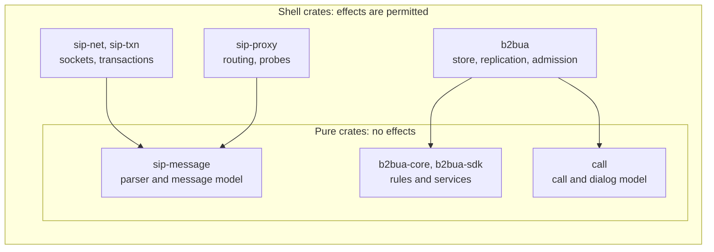

# Engineering rules of the critical code

The guarantees on the other pages depend on how the code is written. This page lists the rules
that the critical crates follow, what each rule gives you, and the tool that checks it. A rule
with no tool is not on this page.

## Summary

| Rule | What it gives you | Check |
|---|---|---|
| No panic on input | A message from the network cannot stop a worker or a proxy. | Lints at deny level, and a count of sites that can only go down |
| The call logic is pure | The same events give the same call, on each worker and in each test. | Dependency check of each pure crate |
| Each loop and each recursion has a bound | One call cannot hold a CPU without end. | A source scanner, in the same count |
| No unsafe code | No memory fault from the code of the platform. | `unsafe_code = "forbid"` for the workspace |
| The service code cannot see HA | A new service gets high availability with no HA code. | Dependency check and a word list |
| One reader for each SIP grammar | A header is parsed the same way in each component. | Code layout, fuzz targets |
| The configuration is checked as one set | A worker with values that contradict each other does not start. | Start-up check, chart render check |
| Each test is a complete call that follows the RFCs | A change that breaks the protocol fails a test. | An audit of 95 RFC rules at the end of each test |

## Two tiers of crates

Each crate that a production binary links declares a tier in its manifest (ADR-0051).

**A pure crate** depends only on pure crates and on a short list of reviewed libraries. It has no
clock, no random source, no file, no socket, no environment variable and no shared mutable
state. It does not use hash maps with a random order. There are 11 pure crates. They hold the
SIP parser, the call model, the rules of the call engine and the service SDK.

**A shell crate** can do effects. It holds the sockets, the timers, the store and the
replication. There are 23 shell crates.

The call logic is a function: a call record and an event go in, a new call record and a list of
effects come out. Three properties of the platform follow from this:

- a backup can continue a call;
- a test with a simulated clock is exact;
- a recorded call can be replayed.

`just purity` checks the tiers. It builds the dependency closure of each production binary. It
refuses a crate with no tier, a test feature, and a pure crate with a dependency that is not
permitted. The check runs on the three binaries that ship: the proxy, the limiter and the route
guard. Add your own worker binary to `purity.toml` to get the same check.

## No panic on input

A crate of the two tiers does not panic on something it reads (ADR-0051).

- These Clippy lints are at deny level outside the tests: indexing, slicing, `unwrap`, `expect`,
  `panic!`, `unreachable!`, `todo!` and `unimplemented!`. The casts that can truncate a value or
  change its sign are in the same set.
- The `assert!` family is not permitted. `debug_assert!` is.
- A list bans the library functions that can panic, such as `split_at` and `Vec::remove`.
- Arithmetic that can overflow is banned module by module.

30 of the 34 tiered crates have no such site and carry the deny attribute. The other 4 are the
limiter, the load-shed library and the metric value store. They have 33 sites in a file-by-file
list, `panic-sites.allow`. The count for a file can go down and cannot go up. A branch that adds
a site on a line it touches is refused.

Four more rules cover what a lint cannot see:

- no recursion that the input controls;
- no allocation with a size from the input and no bound;
- parsing in linear time;
- no `Drop` that can panic.

**The second line of defence.** If a defect passes these rules, the damage stays local.

- The parse of a datagram runs inside `catch_unwind`. A panic there drops one datagram.
- A panic in the logic of one call ends that call with a normal teardown. The other calls
  continue.
- A supervisor starts a long-lived task again when it stops.
- A lock that a panic poisoned is recovered.

## Each loop and each recursion has a bound

A call is bounded, and a turn is bounded (ADR-0057).

- In a pure crate, a loop is a `for` over a finite collection, over a range to a constant or
  over a length. Any other loop goes through `bounds::bounded`, which stops at a stated maximum.
- A recursion goes down through `bounds::Depth`, which refuses past a stated depth or when
  less than 64 KiB of stack is left.
- A source scanner counts the loop and recursion sites that do not follow these forms. The count
  is in the same list as the panic sites, with the same rule: it cannot go up.
- At run time, each call has a limit on its legs, timers, requests and messages, and each turn
  has a limit on its actions. See [overload.md](overload.md#bounds-on-one-call).
- A watchdog measures the CPU time of each step of the runtime. A step above 10 s stops the
  worker, and the backups take its calls.

## No unsafe code

The workspace forbids `unsafe`. Four crates lower this to deny and permit named blocks. They are
`sip-net` for the UDP socket options, the allocator statistics, and two measurement crates.

## The service code cannot see HA

Each crate declares a side, blind or aware. The call model, the rules of the call engine, the
SDK and the services are blind. A script refuses a blind crate that depends on an aware crate.
It also refuses six words of the replication code in a blind crate, with no exception list.
The result is in [services.md](services.md#what-the-engine-does-for-a-service).

## The configuration is checked as one set

A worker or a proxy reads all its settings, then checks the relations between them. If a
relation fails, the process does not start and names each setting involved, all problems in
one message. The Helm chart does the same check at render, and also compares the pod
specification with the settings. [TUNING.md](../TUNING.md) lists each relation.

## Fuzzing

15 fuzz targets run on the readers and on the call logic. Fuzzing finds defects. It does not
gate a merge, and each defect it finds becomes a test.

| Target | What it exercises |
|---|---|
| `message_roundtrip`, `must_accept`, `no_progress` | The SIP parser: parse, render and parse again. Valid input must parse. No reader loop stops. |
| `multipart`, `credentials`, `sdp_answer` | Multipart bodies, authorization headers, SDP offer and answer |
| `initial_invite`, `b2bua_turn`, `unheld_response` | The call logic: a new call, a turn of a call in progress, a response for a call the worker does not hold |
| `proxy_datagram`, `proxy_variants`, `worker_probe`, `overload_value` | The proxy: its path for one datagram in several states, and the answers of the workers it reads |
| `repl_frame`, `call_snapshot` | The replication: the frame reader and the call record |

Property tests cover the same readers on the stable toolchain, with generated input.

## The test rules

The repository has about 9 200 tests. 3 150 of them run on a simulated clock. A call with a 32 s
timer then runs in milliseconds and gives the same result each time.

Each test of a call follows four rules, and the test tools enforce them.

1. **The messages follow the RFCs.** An audit of 95 rules reads all messages of the test when
   it ends. The rules come from RFC 3261, 3262, 3264, 4566, 3263, 3581, 6026, 3311, 3960 and
   6141. A finding on
   a message from the platform fails the test. A test can accept a named rule only for a peer
   that it makes non-compliant on purpose.
2. **The call ends.** Each call reaches its end state before the test ends. A test of a lost
   BYE moves the clock until the platform ends the call by its own timers.
3. **Nothing stays.** The test checks that the engine released the call, its locks, its timers
   and its limiter holds.
4. **The clock is simulated.** A test that needs the real clock for 1 s or more runs in a
   separate, slower set.

The same 95 rules run on captures from a real network, through `sipflow --rfc`. A rule thus
has two uses: it gates the tests, and it reviews traffic.

The test tools are layers. Each layer adds one thing to the layer below it.

| Layer | Adds |
|---|---|
| `sip-net-testkit` | A simulated network that records each message, and the RFC audit |
| `scenario-harness` | Scripted SIP parties and a language for call flows |
| `b2bua-harness` | A real call engine, and the check that nothing stays |
| `failover-harness` | A proxy and several workers that replicate, on one simulated clock, and the failover sweep |

The failover sweep is the proof of the HA guarantee. See
[ha.md](ha.md#how-the-guarantee-is-proven).

## Dependencies

- `just audit-gate` runs `cargo audit`. A branch that changes `Cargo.lock` fails the check on a
  known vulnerability. Each ignored advisory states which crate links it and why that is
  acceptable. Two are ignored today, and neither is in a production binary.
- A production binary cannot link a test feature. The purity check refuses it.

## How to run the checks

| Command | What it runs |
|---|---|
| `just lint` | File sizes, tiers, panic sites, dependency audit, Clippy on all targets |
| `just test` | The default set: all tests but the slow ones |
| `just test-slow` | The tests on the real clock, the load generator tests, the property tests |
| `just sweep` | The failover sweep |
| `just fuzz <target>` | One fuzz target |
| `just hooks` | Installs the commit hook: format, file sizes, panic sites, tiers |
