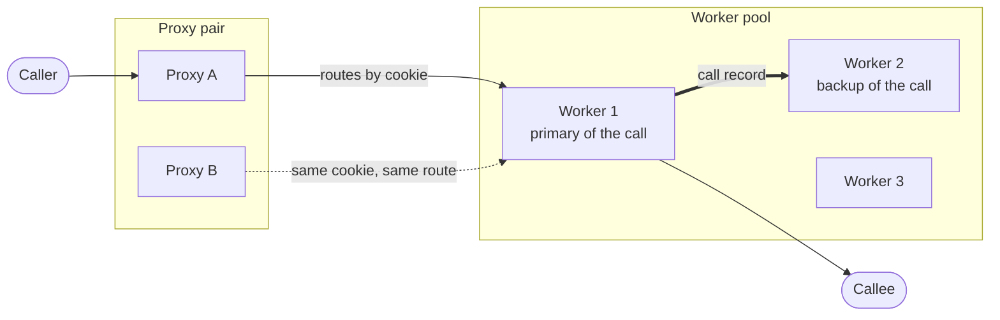
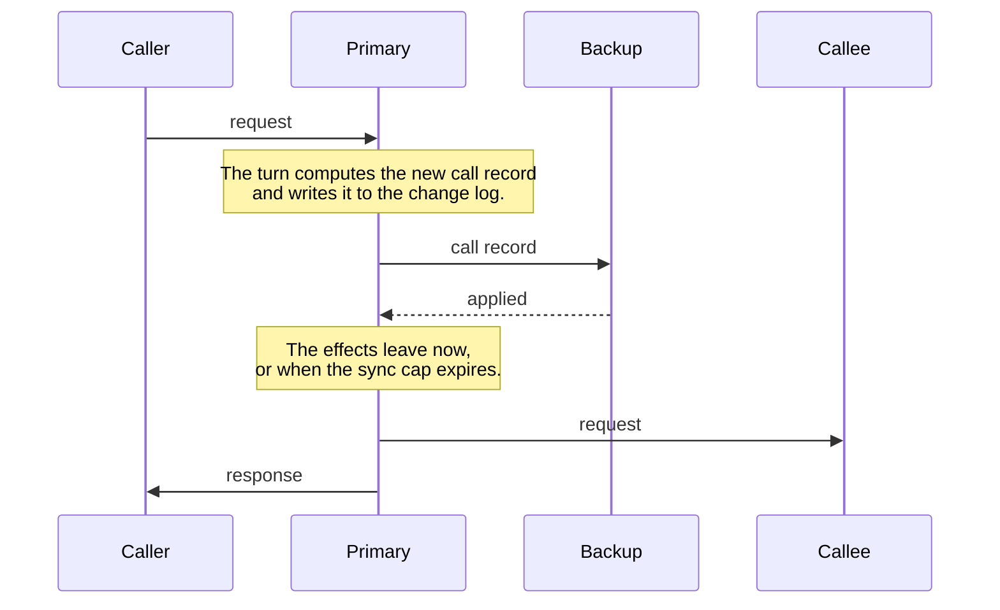

# High availability: guarantees and constraints

This page tells you what the worker pool keeps when a worker is lost, and on which conditions.
It also tells you what the pool does when a condition does not hold. Each statement names the
decision record (ADR) that holds it. The proxy side is in [proxy-integration.md](proxy-integration.md).

## Terms

| Term | Meaning |
|---|---|
| Worker | One B2BUA process. It serves calls and keeps copies of the calls of its peers. |
| Proxy | The stateless front proxy. Two of them route every message to a worker. |
| Primary | The worker that serves a call. The proxy selects it when the call starts. |
| Backup | The worker that keeps the copy of a call. Each call has one backup. |
| Owner | The primary or the backup of a call. |
| Call record | The full state of one call. The primary replicates it to the backup. |
| Turn | The work a worker does for one event of a call: a message, a timer, an answer from a backend. |
| Effect | What a turn sends off the worker: a SIP message, a request to a backend. |
| Sync cap | The longest time an effect waits for the backup. The default is 100 ms. |
| Clean end | The worker ends the call as RFC 3261 permits: a final response, a BYE on each dialog, one CDR. |

## The model

- Each worker is the primary of its own calls and the backup of calls of its peers.
- The workers replicate directly to each other on TCP. There is no external store (ADR-0011).
- The proxy writes the names of the two owners in a signed cookie. The cookie travels in each
  message of the dialog. Thus a proxy needs no state to find an owner (ADR-0055 §8).
- The service logic of a call does not know that HA exists. The call record holds all the state
  of a service, and the replication carries it (ADR-0055 §1).

## The replication round trip

The guarantee depends on one exchange between the primary and the backup. The primary sends the
new call record. The backup applies it and reports its position. This page calls that exchange
the round trip.

Three rules hold on every turn (ADR-0055 §3):

1. The turn writes the call record to the change log before an effect leaves the worker.
2. At sync level `applied`, the default, an effect leaves when the backup applied the write.
3. No effect waits longer than the sync cap. At the cap, the effect leaves without the backup.

Rule 3 is deliberate. A wait without a cap lets one lost peer stop all the calls of a worker.

Three messages have a bound of their own, 200 ms, because the transaction layer must send them
before the peer retransmits: the first 100 Trying, the ACK of a failure response, and the
answers to a CANCEL. If the turn did not release one of them at 200 ms, the transaction layer
sends it. For a new call, the 200 ms of the 100 Trying start when the worker sends the request
to the decision backend, and not before (ADR-0070).

If each round trip completes before these bounds, the backup knows what the parties saw. That
is the condition of the Guaranteed tier.

## The three tiers

The tier of a call follows from measured facts. It does not follow from a setting alone.

| Tier | Conditions | When one worker is lost |
|---|---|---|
| Guaranteed | Sync level `applied`. The call has a live backup. Each round trip of the call completed before the sync cap, and no message left at its 200 ms bound. One worker of the call is lost. | The other owner continues the call. The parties see no deviation from the RFCs, with the three limits below. The call ends later in the usual way, with its CDR. |
| Degraded | Sync level `applied`, and one of the other conditions does not hold. | The call continues, or the worker gives it a clean end, or its dialogs are left to the timers of the endpoints. A closed list of deviations is permitted. See [Degraded operation](#degraded-operation). |
| Off | Sync level `off`. Effects do not wait for the backup. | As Degraded, each time a worker is lost. |

"Lost" means killed, crashed, lost with its node, or restarted. A planned exit is not a loss.
See [Incidents and timings](#incidents-and-timings).

### What no tier promises

These three limits apply in the Guaranteed tier too (ADR-0055 §11).

- **An unreliable provisional response can be lost.** A 180 or 183 sent without RFC 3262 that a
  dead worker held is gone. The caller can then get the final response with no ringing before
  it. A provisional sent with 100rel is not lost.
- **A lost answer comes on the retransmission.** If a worker dies with the answer to a request,
  the sender repeats the request, as RFC 3261 section 17 requires. The other owner answers the
  repeat. Your endpoints must retransmit as the RFC requires.
- **A backend can get one request two times.** The owner that continues a call sends again the
  request whose answer died with the other owner. Your decision service and your limiter must
  accept a repeated request (ADR-0039).

### The CDR count

The worker that ends a call writes its CDR (ADR-0055 §5).

| Case | CDRs for the call |
|---|---|
| No incident | 1 |
| The backup is lost | 1 |
| The primary is lost and the call had a backup | 1 or 2 |
| The replication stalls, then the primary is lost | 1 or 2 |
| The call had no backup and its worker is lost | 1 or 0 |
| A split that heals | 1 or 2 |
| A split that does not heal | 0, 1 or 2 |

These are the CDRs that the workers write. A worker keeps a written CDR in memory until it
publishes it, and a worker that dies loses the CDRs it did not publish. See
[What HA does not cover](#what-ha-does-not-cover).

Two CDRs of one call carry the same `incarnation`. Your billing chain must remove the duplicate
with this field. Do not use `call_ref`: a caller that sends its INVITE again with the same
Call-ID and From tag makes a new call with the same `call_ref` and another `incarnation`.

## Degraded operation

The pool does not stop when a condition fails. It continues with a weaker promise, and a metric
shows each case.

| What fails | What the worker does | What you lose if a worker dies then | Metric |
|---|---|---|---|
| The round trip is slower than the sync cap | The effect leaves at the cap. The write stays in the change log until the backup applies it. | The backup can be behind the parties. It gives the call a clean end on the first message that shows the difference. | `b2bua_repl_outbox_released_total{reason="capped"}` |
| The backlog to the backup is above its high mark (10 000 writes or 5 s) | New calls start with no backup, and keep none for their whole life. No call is refused. Below the low mark (1 000 writes and 1 s), new calls get a backup again. The marks are measured for each backup. | A call with no backup dies with its worker. | `b2bua_repl_calls_unbacked` |
| The backup is at its ceiling for copies, a count or a memory size | It refuses the copy. The call has no backup for its whole life. | The same. | `b2bua_repl_backup_shed_total{bound}` |
| The link to the backup goes down | Waiting effects leave immediately. | The calls written during the cut are in the same case as a slow round trip. | `b2bua_repl_outbox_released_total{reason="backup_lost"}`, `b2bua_repl_serving_flows` |
| The backup is restarting | New calls are admitted. The bootstrap of the backup brings them. | A call is not protected until the bootstrap completes. | `b2bua_repl_serving_flows` |
| The two owners cannot reach each other, and the parties reach both | Each owner serves what reaches it. See [Split](#split). | The call can end. | `b2bua_repl_serving_flows` |

### What a clean end is

When the record of the surviving owner cannot explain a message, the owner does not guess. It
ends the call (ADR-0055 §4):

- it sends what RFC 3261 requires for the message;
- it sends a BYE on each dialog that the record or the message names;
- it writes one CDR and releases each limiter hold.

In the Degraded tier, the permitted deviations are a closed list. Each one has a name and a test
that triggers it. The most visible ones are:

- a request into a dialog that the dead owner already ended. The peer answers 481, one time for
  each dialog;
- a dialog that only its endpoints can end, with their own timers. This occurs when the dead
  owner held a teardown, or the effects of a response or of a timer, that the backup never
  received;
- a second attempt to the callee, when the routing decision died with the primary at sync
  level `off`;
- a 503 to the caller, when the routing decision died with the primary after the start bound
  (`B2BUA_CALL_START_BOUND_MS`, counted from the receipt of the INVITE). The backup does not
  ask the decision backend again (ADR-0070).

Three results are never permitted, and each is a defect:

- a call that stays open with no owner;
- a request with no final response from a live worker;
- a resource that is not released.

### Split

A split is a partition that cuts the owners from each other while the parties reach both.
The pool does not prevent a split. It reconciles the two copies when the link returns
(ADR-0055 §7).

- If one copy contains all the changes of the other, the pool keeps that copy.
- If each copy contains the other, the pool keeps the copy of the primary.
- If neither contains the other, the call gets a clean end on each dialog that the two copies
  know.

No clock decides between two copies. A worker that finds its name bound to another process
stops immediately (ADR-0055 §6).

## What HA does not cover

| Case | Result |
|---|---|
| The two owners of a call are lost together | The call is lost. The endpoints end their dialogs with their own timers. |
| The two proxies are lost together | The service address is unreachable until one proxy returns. |
| A primary stays down longer than the lifetime of a copy (`B2BUA_REBOOT_BUDGET_SEC`, 600 s) and no request arrives for a call | The backup ends its copy of that call and writes the CDR. A later request for the call gets 481. |
| A worker is lost before it published a CDR | That CDR is lost. The worker keeps CDRs in memory until it publishes them, and drops new ones when its queue is full. The queue of the broker has a maximum length and drops its oldest record. Counters show the loss at each stage. |
| The decision backend is fully down | New calls are refused with 503. Calls in progress continue. |
| The limiter is down | Calls are admitted without a count. The limiter fails open. |
| A survivor is above its admission ceilings after a takeover | It keeps the calls it took over. It refuses new calls until its count falls. See [overload.md](overload.md). |

The backup of a call is any peer. The selection does not know zones or racks. Do not put the
workers of one pool on links that cannot complete the round trip in the sync cap.

## Incidents and timings

All values are the defaults.

| Incident | How the pool sees it | What it does | The parties see |
|---|---|---|---|
| Planned exit: rolling update, drain, scale-down | The worker gets SIGTERM, or sees its own endpoint withdrawn. | It serves its calls until its backups hold them or the calls end, for 5 s at most. Then it sends its last limiter releases and CDRs, and exits (ADR-0031). A worker with no call exits immediately. | Nothing, for a call that a backup holds. |
| Worker Service deleted and created again | All endpoints leave the slice at the same time, the endpoint of each worker included. | No worker drains and no backup takes over. Each worker keeps its calls. Until the endpoints return, the proxy has no worker to route a new call to and answers it 503, and it drops an in-dialog request (BYE, re-INVITE) unanswered (ADR-0031). A peer that fails during the gap is taken over only when the endpoints return. | New calls get a 503 for the time of the gap. An in-dialog request goes through on a retransmission after the endpoints return, before the client's transaction timeout (Timer F or B, 32 s); a longer gap fails it, and a selector that matches no pod keeps the gap open. |
| Worker killed or node lost | The probe of the proxy reads it dead in 2.6 to 3.6 s. Each backup confirms on its own replication stream. | The backup takes over the calls with work in flight, 6 to 8 s at most after the verdict. A quiet call moves on its next request (ADR-0047). | Retransmissions, then the call continues. |
| Worker slow: its probe answers arrive between 1.6 s and 2 s after the probe | The proxy reads it slow in 2.6 to 3.6 s, and alive after three answers in time. | Nothing is taken over. The worker keeps its calls and gets no new call (ADR-0069). | Slower answers from that worker. |
| Worker slow, then killed | The proxy reads it dead at most 3.6 s after the last answer it received from it, 3 s after a late one (the slow window and one probe interval). | As for a kill. | As for a kill. |
| Worker slow, then restarted | Its first answer in time names a new identity: the proxy reads it dead. | As for a kill. | As for a kill. |
| A CANCEL crosses to the other proxy while a worker is slow | That proxy holds no memo of the INVITE. It sends the CANCEL to the first worker in rank that serves dialogs, which can be the slow worker the INVITE went past. | The worker holding the INVITE does not get the CANCEL. | The call rings until its own timers end it. |
| One proxy reads every worker slow, the other reads them alive | The proxy stays announced. | It answers the normal new calls of its flows 503. | The SBC retries those calls elsewhere. |
| Worker alive, its answers later than 2 s | The proxy reads it dead, as a killed worker. Its backup still hears its stream. | Its requests inside a dialog go to the backup while it runs, until it exits or answers in time again. | Requests of its calls answered by the backup. |
| Every worker turns slow in the same probe round | From the last answer in time to the first late one, more than 2 s can pass: each proxy reads isolated meanwhile. | The route guards withdraw the POP. It returns after the first late answer and the guard's hold. | The SBC sends the POP's traffic to the other POPs for about 10 s. |
| Worker restarted | It returns empty, with a new identity. | It takes its calls back from the backups. It reads ready when it holds them, or after 10 s if it cannot reach a peer (ADR-0014). | Nothing more than for the kill. |
| Backup lost | The stream of the primary to it ends. | The primary continues. Its calls have no backup until the backup returns and completes its bootstrap. | Nothing. |
| Replication link cut, then restored | A stream with no data for 2 s reads down. | The puller connects again and continues from its position (ADR-0045). | Nothing, if the cut is short. |
| One proxy lost | The routers remove its routes. | The other proxy routes with the cookie. | Retransmissions. |
| The POP returns after a total outage | Its proxies read fit again. | It takes its full share at once. The workers' admission refuses the excess with fast 503s. | The SBC retries the refused calls elsewhere. |
| A backend answers slowly, inside its budget | The request has a deadline (ADR-0039). | The call waits for the answer. | A longer setup. |

At the end of the grace of a planned exit, the worker ends each call that no backup holds. A
caller in setup gets 503. An established call gets its CDR and nothing on the wire, so the
worker does not cut media that still flows. The chart refuses a pod grace period that is
shorter than the planned exit.

A call with nothing in flight needs no action at the loss of its primary. The backup takes it
when its next request arrives. This prevents a burst of traffic on each failover.

## What you must provide

1. **Two workers or more.** Each call has one backup. A pool of one worker runs with no HA.
2. **A fast link between all the workers.** The round trip must complete well below the sync
   cap. Put the pool in one site. The link must also carry one record at the record cap in
   2 s: 8 MiB/s at the default cap of 16 MiB. On a slower link, a stream that carries a
   record at the cap reads down and starts again.
3. **One shared key, on the workers and on the proxies.** Each worker gets the same
   `B2BUA_CLUSTER_KEY`, 32 to 64 bytes of text. A worker with replication on refuses to start without it. Give the same
   key to each proxy as `PROXY_CLUSTER_KEY`. A proxy with no key cannot tell the backups that a
   worker is dead. The calls with work in flight then wait until Kubernetes removes the pod,
   which takes minutes.
4. **Clocks that slew.** Use chrony in slew mode on the hosts. A clock that steps makes the
   timers of a copy fire early.
5. **Memory for a takeover.** A survivor holds its own calls and the copies it turns live.
   Size its limit for the two. See [overload.md](overload.md#sizing).
6. **Backends that accept a repeat.** See [What no tier promises](#what-no-tier-promises).
7. **A CDR consumer that removes duplicates.** See [The CDR count](#the-cdr-count).
8. **Endpoints that follow RFC 3261.** The guarantee uses their retransmissions.

## Settings

| Setting | Default | Role |
|---|---|---|
| `B2BUA_REPL` | off | Turns the replication on. |
| `B2BUA_REPL_SYNC` | `applied` | The sync level: `applied` or `off`. |
| `B2BUA_REPL_SYNC_CAP_MS` | 100 | The sync cap. It must stay below the two bounds of the next row. |
| `B2BUA_REPL_ACK_BOUND_MS`, `B2BUA_REPL_CANCEL_BOUND_MS` | 200, 200 | The longest wait of the ACK of a failure response, and of the answers to a CANCEL. Each must stay below SIP timer T1 (500 ms). |
| `B2BUA_REPL_BACKLOG_HIGH_ENTRIES`, `_HIGH_AGE_MS` | 10 000, 5 000 | The backlog above which a new call gets no backup. |
| `B2BUA_REPL_BACKLOG_LOW_ENTRIES`, `_LOW_AGE_MS` | 1 000, 1 000 | The backlog below which a new call gets a backup again. |
| `B2BUA_REBOOT_BUDGET_SEC` | 600 | The lifetime of a copy that no write refreshes. |
| `B2BUA_DRAIN_GRACE_MS` | 5 000 | The longest time a planned exit waits for its calls. |
| `B2BUA_DRAIN_MIN_MS` | 1 000 | The shortest planned exit of a worker whose backups hold its calls. |

A worker checks the relations between these values when it starts. If one relation fails, the
worker does not start and names each value involved. [TUNING.md](../TUNING.md) gives each
relation and the effect of a higher or lower value.

## What to monitor

| Metric | Read it as |
|---|---|
| `b2bua_repl_outbox_released_total{reason}` | `applied` is the Guaranteed path. `capped` counts round trips slower than the sync cap. `backup_lost` and `no_live_backup` count effects that had no backup to wait for. `call_released` counts the effects of a call that the worker released. |
| `b2bua_repl_calls_unbacked` | Live calls with no backup. Zero in normal operation. |
| `b2bua_repl_serving_flows{state}` | Replication streams: `live`, `stale`, `down`. Alert on `stale`. |
| `b2bua_repl_backup_shed_total{bound}` | Copies that a backup refused at its ceiling: `calls` or `rss`. |
| `b2bua_repl_takeover_hydrated_total` | Copies turned live by a takeover. |
| `b2bua_drain_exits_total{reason}` | How each planned exit ended. `caught_up` and `quiescent` are the transparent ones. |
| `b2bua_clock_wall_divergence_ms` | The drift of the wall clock of the host against its monotonic clock. A step of the host clock shows here. The worker warns above 500 ms. |
| `b2bua_cdr_dropped_total{reason}` | CDRs that a worker did not deliver, by reason. `close_deadline` counts the CDRs that the exit bound cut. |

## How the guarantee is proven

- **A failover sweep.** 15 call flows are cut at each point of each turn, by 8 incidents, at
  the 2 sync levels. A cut point is one of three instants: the write is in the change log, the
  backup applied it, the effects left. Each cell must end with a fully terminated call that
  passes the RFC audit, the correct CDR count and no leaked resource.
- **A count that cannot fall.** 1 488 cells are in the Guaranteed tier today, in 60 tests.
  The list of failing cells is empty. A change that lowers a count fails the build.
- **A closed list of deviations.** Each permitted deviation of the Degraded tier is one named
  row with a test that triggers it. A deviation with no row is a defect, in the tests and on a
  real cluster.
- **Runs on a real cluster.** A runner injects incidents under load: worker kill, node stop,
  partition, packet loss, clock skew. It charges each failed call to the incident that
  caused it and compares the total to a budget.

The sweep and its tiers are in
[ADR-0055](../adr/0055-services-are-ha-blind.md) and
[testing/ha-acceptance.md](../testing/ha-acceptance.md).
