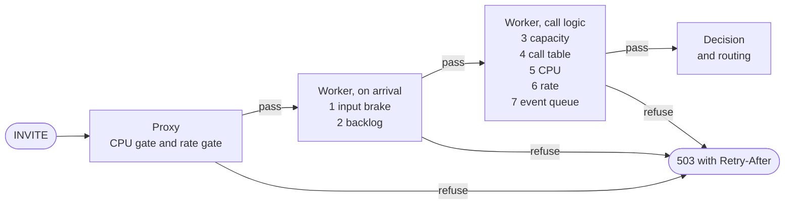

# Overload protection

A worker under more load than it can carry stays up and keeps the calls it has. It refuses new
calls early, with an answer that tells the caller when to try again. This page lists each
protection, its limit, and what the caller sees.

## The five promises

1. **New calls are refused before memory or CPU runs out.** Ceilings on live calls, on live
   transactions and on process memory bound what a worker admits (ADR-0037). You must set the
   ceilings: they are off by default.
2. **Calls in progress continue while the worker has the CPU to serve them.** A request inside
   a dialog passes the load checks. No limit refuses the BYE, CANCEL or ACK that a worker
   sends, or their answers. When the worker has less CPU than its calls in progress need, the
   worker refuses all new calls, and calls in progress can fail: a re-INVITE can time out and a
   call can end. The failures stay on the calls of that worker, and each call ends at both
   parties. See [A worker with less CPU than its load needs](#a-worker-with-less-cpu-than-its-load-needs).
3. **Emergency calls pass the load gates.** They stop only at their own, higher ceilings.
4. **A caller that got 100 Trying gets a final response from a live worker.** The call is
   forwarded, or the caller gets 503 in 5 s, for each internal failure (ADR-0022).
5. **One call cannot take the worker.** Each call has a bound on its messages, its legs, its
   timers and the work of one turn. A call that passes a bound is ended (ADR-0057).

## Where a new call can be refused



A new INVITE meets the gates of the proxy, then seven checks in the worker, in a fixed order.
The first two run before the worker creates a transaction, so a refusal there is cheap.

| # | Check | It measures | Limit (default) | Normal call | Emergency call |
|---|---|---|---|---|---|
| 1 | Input brake | Depth of the UDP input queue | 70 % of 8 192 datagrams, or while check 7 refuses | Refused | Passes |
| 2 | Backlog | Events that wait for the call logic | 4 096 events | Refused | Refused at 8 192 |
| 3 | Capacity | Live calls, live transactions, process memory | Off until you set them | Refused at the normal ceiling | Refused at the emergency ceiling |
| 4 | Call table | Live per-call queues | 1 000 000, less 5 % for normal calls | Refused at 95 % | Refused at 100 % |
| 5 | CPU | Smoothed use of the event loop | 0.75 | Refused | Passes |
| 6 | Rate | A token bucket of new calls | 500 a second, burst 1 000 | Refused | Passes |
| 7 | Event queue | Depth and age of the event queue, and the wait of the oldest datagram in the UDP input queue | 512 events, or 300 ms for 150 ms | Refused | Passes |

The proxy has two gates of its own before these. It refuses new calls when its own CPU use is
above 0.8 or its rate bucket is empty. It also sends new calls away from a worker that reports a
high load. See [proxy-integration.md](proxy-integration.md).

The capacity ceilings are off by default. A worker with no ceiling relies on checks 1, 2 and 4
to 7 only. Set the ceilings for production. See [Sizing](#sizing).

## The refusal on the wire

A refused INVITE gets `503 Service Unavailable` with these properties:

- a `Retry-After` between 5 and 10 s, different for each call, so the callers do not return
  together;
- no `Reason` header;
- the same bytes for each retransmission of the INVITE, for 32 s. The worker keeps no
  transaction for it.

Three refusals have no `Retry-After`, because an early retry does not help:

- the setup budget is spent;
- the decision backend is down;
- an operator cordoned the worker.

## What is never refused

| Item | Guarantee |
|---|---|
| A BYE, CANCEL or ACK that the worker sends, and the answers to them | No table, queue or limit refuses them. The kernel can lose one at a full socket buffer. The retransmission timers then recover it. |
| The answer of a backend to a request of a call | Always accepted. |
| A call that a takeover makes live | It meets no ceiling. It counts in the totals, so new calls are refused until the totals fall. |
| A request inside a dialog | It passes checks 1 and 3 to 7. Two bounds stay: the backlog at 8 192 events, and 64 queued events for one call. |

When a request inside a dialog meets one of those two bounds, a re-INVITE gets 503 or 500 with
`Retry-After` and the dialog stays. The worker drops any other request and serves its
retransmission.

## A worker with less CPU than its load needs

A worker can have less CPU than its load needs: its CPU limit is too low, or its host is busy.
The work then waits in the UDP input queue, and the CPU reading of check 5 can stay low.

Check 7 measures how long the oldest datagram in that queue has waited. When the wait stays at
300 ms for 150 ms, the worker refuses each new normal call with 503 and `Retry-After`. Check 1
then makes that refusal before the call enters the queue. One old datagram, found after a pause
of the process, causes no refusal: the wait must stay for 150 ms. The worker also reports the
refusal in its answer to the probe of the proxy. The proxy then sends new calls to the other workers. Emergency calls pass.
The worker accepts new calls again when the waits of the two queues stayed at 50 ms or less, and
the event queue at 64 events or less, for 3 s.

The worker takes the probe of the proxy before the datagrams that wait. The proxy thus gets its
answer in time, and usually does not read a slow worker as dead. Two limits stay. The worker
takes at most 64 probes before the other datagrams. A worker that cannot read its socket as fast
as datagrams arrive answers the probe late.

The 450 ms is the wait of the oldest datagram. A datagram that arrives at that moment waits
longer: 450 ms multiplied by the ratio of the arrival rate to the rate at which the worker takes
datagrams.

The result depends on the CPU that the calls in progress need:

| The worker has | Result |
|---|---|
| The CPU that its calls in progress need | Call setups are refused or slow. Requests inside a dialog are late and do not fail. The proxy does not read the worker as dead. |
| Less CPU than its calls in progress need | The worker refuses all new normal calls. Calls in progress can fail: a re-INVITE can time out, and a call can end. When the worker also answers the probe late, the proxy reads it as dead and routes its calls to their backups. The failures stay on the calls of that worker, and each call ends at both parties. |

The second row is a limit of the design. To stay in the first row, give each worker a CPU limit
above the CPU that its calls in progress use at the nominal load. See [Sizing](#sizing).

## Emergency calls

The worker and the proxy read a call as an emergency call when its `Resource-Priority` header
has `esnet.0`, `wps.0` or `q735.0`. Nothing else marks a call: not the dialled number, not a
service URN.

An emergency call passes the input brake, the CPU check, the rate bucket and the event queue
check. These refuse it:

- an emergency ceiling;
- a full call table;
- a backlog at twice the normal limit;
- a cordoned worker;
- a spent setup budget, or a decision backend that is down.

## The first INVITE always gets a final response

When a worker sent 100 Trying, the caller stops its own timers and waits. The worker then owes a
final response, for all internal failures (ADR-0022). The promise is that of a live worker. If
the worker dies, the backup of the call keeps the promise. A call with no backup has none: see
[ha.md](ha.md#what-ha-does-not-cover).

- One setup budget of 5 s (`B2BUA_CALL_CONTROL_TIMEOUT_MS`) runs from the receipt of the INVITE.
  It covers the wait for a slot, each request to the decision backend, each limiter request and
  the retries on other routes.
- When the budget is spent, the caller gets 503. With replication on, the 503 can leave up to
  100 ms later, at the sync cap.
- A call that ends unanswered for a different internal reason gets the same 503 from one last
  check, so no path can forget the caller.

After the routing, different bounds apply. If a callee sends nothing in 5 s, the worker asks the
decision for a different route. With no other route, the caller gets 480. A call that rings for
150 s gets 408.

## When a backend fails

| Backend | Bound | When it does not answer | Effect on calls |
|---|---|---|---|
| Decision service | 5 s in total for a call setup | The worker stops sending when 3 requests in 2 s get no answer of any kind. It probes each second. | New calls get 503. Calls in progress continue. |
| Call limiter | 150 ms for an admit | The call is admitted without a count. | No call is refused. A limit can be passed during the failure. |
| CDR sink | A queue of 1 024 records | The worker drops the record and counts the drop. | None on calls. |

The decision service row applies to a decision engine built on the HTTP backend client of this
repository (`http-net`). One HTTP answer of any status closes the breaker again. A request is sent a second time only
after a connection failure, and only if its budget leaves time for a full attempt (ADR-0043).

The limiter fails open by design. A limiter failure must not stop the service
(ADR-0040). A limit that must hold during a limiter failure needs a different control.

## Bounds on one call

These bounds stop a call that grows without end, by a fault of a peer or a defect in a service.

| Bound | Default | When passed |
|---|---|---|
| Messages of one call between two keepalives | 200 | The call is ended. The BYE carries `Reason: SIP;cause=503;text="message-cap-exceeded"`. |
| Legs of one call | 1 200, plus 600 for each hour | The turn is cancelled and the call is ended. |
| Timers of one call, open requests of one call | 400 each | The same. |
| Dialogs of one leg | 100 | The same. |
| Actions of one turn | 100 000 | The same. |
| Size of the record of one call, encoded | 16 MiB | The same. The record is measured when the worker writes it, so the turn's record is not written and not sent to the backup. A BYE is never refused, so a BYE can leave a record above the bound. A worker with a lower bound can take over a record above its bound. In both cases the next write of the call ends it. |
| Events queued for one call | 64 | See [What is never refused](#what-is-never-refused). |

You can raise a bound. You cannot remove one. A worker refuses to start with a bound at zero, or
with a record size above 32 MiB, half of the 64 MiB replication frame.

A call that the worker ends for a bound gets a normal teardown. Each leg gets a BYE or a CANCEL,
and a caller with no answer gets 503. The name of the bound does not go on the wire. It goes in
`b2bua_cap_trips_total`.

### Calls that do not end

A call cannot stay in a worker with no owner.

| Mechanism | Default | Effect |
|---|---|---|
| Keepalive | An OPTIONS in each dialog each 300 s | No answer in 32 s, or an answer that shows the dialog is gone, ends the call. |
| Teardown timer | 32 s | A teardown that gets no answer ends at this time. |
| Maximum duration | Set by the decision for each call. 1 h when the decision gives no value. | The call is ended at this time. |
| Reaper | A sweep each 30 s | A call with no activity for 900 s is released, with its CDR. |

## The process

| Fault | Detection | Action |
|---|---|---|
| The event loop does not turn | 10 s | `/ready` and `/healthz` answer 503. A worker that also stops answering the probe of the proxy reads dead in 3.6 s. The proxy then routes its calls to their backups. |
| The event loop still does not turn | 15 s | The process exits. With HA, the backups take the calls. |
| One call spends 10 s of CPU in one step | A watchdog thread reads the CPU time of each runtime thread | The worker leaves that call to its parties and exits with code 70. |
| A long-lived task panics | Immediate | The task starts again after 1 s. |
| The logic of one call panics | Immediate | That call is torn down on the wire and released. The other calls continue. |

An overload is none of these faults. A UDP input queue that never empties holds no event loop:
the worker and the proxy read at most 128 datagrams of it in a row, then the other work of
their thread runs, as the timers, the answers to the probes and the finals of the calls. The
watchdog thus never reads an overload as a stuck step.

The code of the worker and the proxy is written so that input cannot cause a panic. See
[engineering-rules.md](engineering-rules.md). The rows above are the second line of defence.

## Sizing

The capacity ceilings come in pairs, and each pair has a relation that the worker checks when
it starts.

| Setting | Role |
|---|---|
| `B2BUA_MAX_CALLS`, `B2BUA_MAX_CALLS_EMERGENCY` | Live calls above which normal calls, then all calls, are refused. |
| `B2BUA_MAX_TXNS`, `B2BUA_MAX_TXNS_EMERGENCY` | The same for live SIP transactions. |
| `B2BUA_MAX_RSS`, `B2BUA_MAX_RSS_EMERGENCY` | The same for the memory of the process. |
| `B2BUA_REPL_BACKUP_MAX_CALLS`, `B2BUA_REPL_BACKUP_MAX_RSS` | Copies that a worker keeps for its peers. |

The emergency value must be above the normal value. The backup ceiling must be at or above the
emergency ceiling of each peer, so that each admitted call can have a backup.

Size the memory limit of a worker for a takeover. A survivor holds its own calls and each copy
it turns live:

```
memory limit × (1 − slack) ≥ base + (C + B) × bytes per call + (N + reserve) × bytes per transaction
```

`C` is the emergency call ceiling, `B` the backup ceiling, `N` the transaction ceiling.

The chart computes all the ceilings and the memory when you set `sizing.enabled`. You give it a
traffic profile: the calls a second, the mean call duration and the mean ring time. You also
give it the measured bytes for a call and for a transaction. [TUNING.md](../TUNING.md) gives the
method and a worked example.

After a takeover, a survivor above its ceilings keeps all its calls and refuses new ones until
its count falls. With a mean call duration `T`, `L` live calls and a ceiling `C`, that takes
`T × ln(L / C)`.

## What to monitor

| Metric | Read it as |
|---|---|
| `b2bua_new_calls_total{outcome,reason,class}` | Each new call, and why a refused one was refused. |
| `b2bua_capacity_level` | 0: open. 1: normal calls refused. 2: all calls refused. |
| `b2bua_active_calls`, `b2bua_txn_active_transactions`, `b2bua_capacity_rss_bytes` | The three quantities against their ceilings. |
| `b2bua_overload_elu_ewma` | The CPU reading of check 5. |
| `b2bua_udp_tail_dropped_total` | Datagrams lost at a full input queue. |
| `b2bua_event_queue_refusing` | 1 while check 7 refuses. |
| `b2bua_udp_queue_wait_ms` | The wait of the oldest datagram in the UDP input queue. |
| `b2bua_cap_trips_total{cap}` | Calls ended for a bound. |
| `b2bua_cap_peak{cap}`, `b2bua_call_record_bytes` | How near calls come to each bound. The histogram gives the size of each call record that a worker writes. |
| `b2bua_limiter_breaker_open`, `b2bua_limiter_uncounted_calls` | The limiter is unreachable, and how many calls run without a count. |
| `b2bua_cdr_dropped_total{reason}` | CDRs that a worker did not deliver. `buffer_full` counts the CDRs lost at a full queue. |
| `b2bua_loop_stalled` | 1 while the event loop does not turn. |
| `sip_proxy_self_external_invites_rejected_total` | New calls the proxy refused for its own load. |

A Grafana dashboard for these metrics ships in `tooling/hakit/content/dashboards/`.
