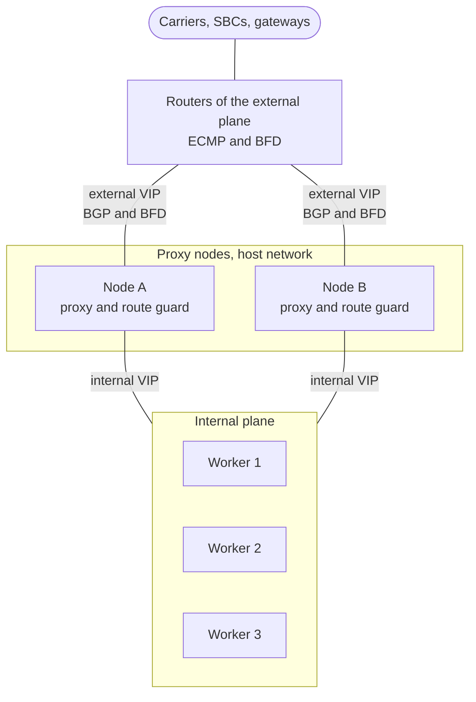
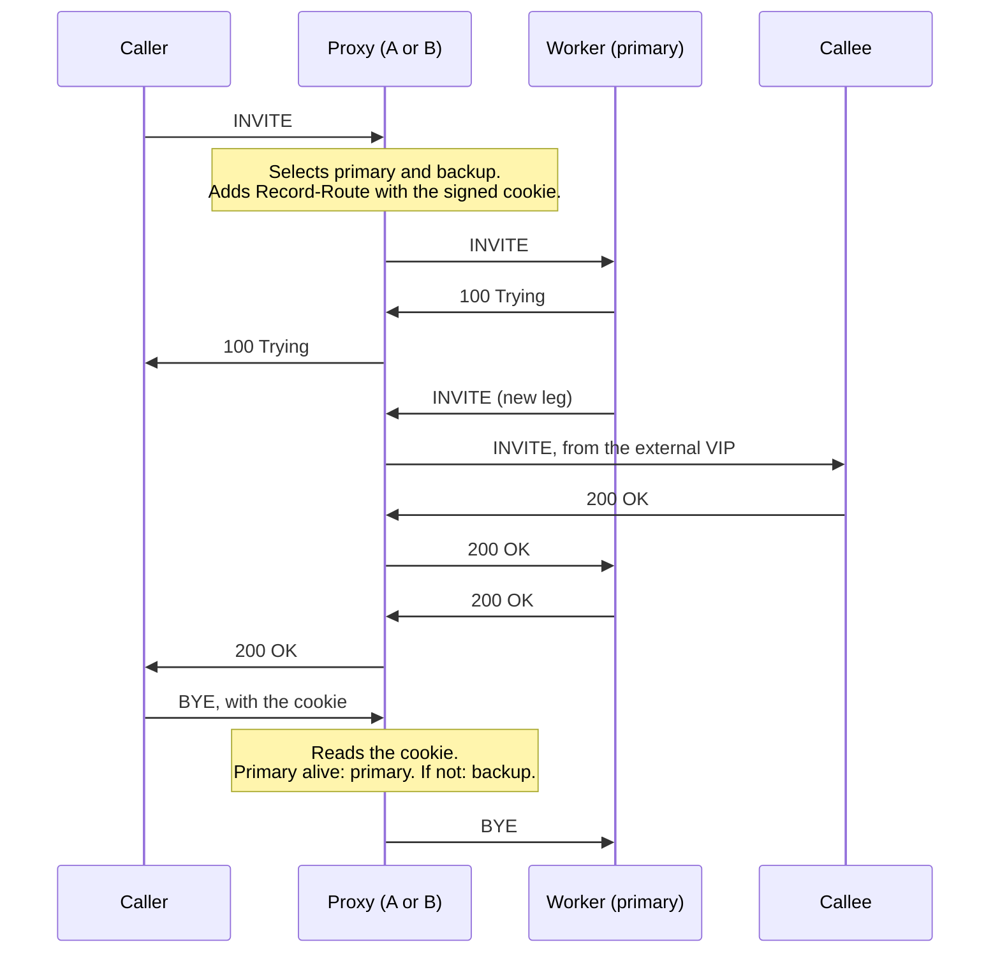

# Front proxy: how to integrate it

The front proxy is the single SIP address of the platform. Two proxies, both active, put the
worker pool behind that address. This page gives the recommended integration mode, what your
network must provide, and what a caller gets when a part fails.

The worker side of high availability is in [ha.md](ha.md).

## What the proxy does

The proxy is a stateless RFC 3261 proxy (ADR-0009). It keeps no dialog and runs no transaction
state machine. It sends no 100 Trying and runs no timer for a call. It reads each message,
selects a worker and forwards the message.

The proxy keeps one bounded memory, for speed and not for correctness. It records where each
INVITE went, so that a CANCEL, an ACK or a retransmission follows it. It also records each
refusal for 32 s. A proxy that restarts starts with an empty memory.

| Message | Where it goes |
|---|---|
| New call | The proxy ranks the live workers by a hash of the Call-ID. It selects the first one that accepts new calls as the primary, and one more as the backup. |
| Request inside a dialog | The primary named in the cookie, if it is alive. If not, the backup. If neither is alive, the proxy drops the request. |
| Response | The worker that sent the request. If it is gone, the other owner of the call. |
| Request from a worker to the outside | The address the worker names. The proxy sends it from the external address. |

**The cookie.** On the first request of a dialog, the proxy adds its own Record-Route entries.
One entry carries a cookie with the names of the primary and the backup, signed with
HMAC-SHA256. Each later request of the dialog brings the cookie back. Thus the two proxies route
the same dialog to the same worker with no shared state. A request with a bad signature gets
403.

**The probe.** Each proxy sends an OPTIONS to each worker once a second. A worker that misses
two probes reads dead after 2.6 to 3.6 s. A worker that misses them but answers between 1.6 s
and 2 s after the probe reads slow: it keeps its calls and gets no new one. It reads alive again
after three answers in time. A worker that answers later than 2 s reads dead (ADR-0069). The
dead verdict lands at most 3.6 s after the last answer the proxy received from the worker. The
answer of a live worker tells the proxy if the worker accepts new calls, and how loaded it is.

**The supervision OPTIONS.** An OPTIONS to the proxy's advertised address, or to an address the
proxy binds by name (not `0.0.0.0`), with no user part and no To-tag, is answered by the proxy:
200 while a worker is alive or slow, with the `Allow`, `Supported` and `Accept` of the last 200
of a worker. With no such worker it gets no answer, and the supervisor's timeout takes the POP
out. It uses none of the new-call budget.

**The return after an outage.** A POP back in rotation takes its full share of new calls at
once. The workers' admission refuses any excess with fast 503s, which the SBC retries elsewhere.

## The recommended mode

Run the platform on Kubernetes with the chart in `deploy/helm/siprust`. The chart is the only
deployment that ships, and it checks the relations between its values when it renders.

1. **Two addresses.** The proxy pair has one external VIP for the callers and one internal VIP
   for the workers. Each proxy node holds the two VIPs on its loopback interface.
2. **Host network.** Each proxy pod runs on the network of its node, on nodes you reserve for
   the proxies. No worker runs on a proxy node.
3. **BGP announces the VIPs.** MetalLB in BGP mode announces each VIP from each node whose
   proxy pod is Ready. Your routers share the flows between the nodes with ECMP. The two
   proxies carry traffic at the same time (ADR-0056).
4. **BFD removes a dead node.** The routers run BFD on each session and withdraw the routes
   of a node when BFD goes down, in about one second.
5. **The route guard removes a sick node.** A container beside the proxy reads the
   fitness of the proxy 10 times a second. When the proxy is unfit, hung or dead, the guard
   stops the BFD and BGP packets of the node. The routers then withdraw the node as for a dead
   one.
6. **The proxy finds the workers.** It watches the EndpointSlices of the worker Service and
   sends to each worker at its pod address. There is no DNS in the data path.

All SIP messages of a worker go through the proxy, in the two directions. The outside sees one
source address, the external VIP, in the IP header, in Via and in Contact.

## The path of a call

The caller and the callee can use different proxies for each message. The result is the same.

## What your network must provide

The full list, with the reason for each item, is in
[deploy/README.md](../../deploy/README.md#production-deployment-requirements-the-front-proxys-announcement).
The items that decide the design are these.

- **Routers with ECMP on layer 4** over the proxy nodes. Resilient hashing is better: a node
  that joins then moves few flows.
- **BFD on each BGP session, and no BGP graceful restart.** Graceful restart keeps the routes of
  a dead node.
- **Two planes that do not mix.** The internal VIP is not routable from the external plane, and
  the external VIP is not routable from the internal plane. Use separate routers or one VRF for
  each plane.
- **A firewall on the proxy nodes.** The VIPs are local addresses of a node. Each service of the
  node that listens on all addresses answers on the external VIP, the kubelet included.
- **kube-proxy in iptables or nftables mode.** The IPVS mode is not supported.
- **An external router that sends traffic back on the interface it came from.** A proxy node
  sends all traffic of the external VIP to a next hop. The router must not drop it for its
  source address and must not send ICMP redirects.
- **A path that carries IP fragments** between the proxies and each SIP peer. See
  [Limits](#limits).
- **No other BGP session from a proxy node to the same routers.** The route guard cuts it
  together with the session of MetalLB.

## Trust: two faces

The proxy has two sockets, and it trusts a message by the socket it arrived on (ADR-0048).

| Face | Who is there | What the proxy accepts |
|---|---|---|
| Internal | The workers | A request from a known worker is an outbound request. The proxy follows its Route header. |
| External | Everyone else | A new call, or a request with a valid cookie. The proxy removes each Route entry that is not its own. A response goes only to a known worker. |

Nothing on the external face can pass for a worker. This holds only if your network keeps the
two planes apart. A caller that can send to the internal VIP is trusted as a worker.

A call with an emergency Resource-Priority value (`esnet.0`, `wps.0`, `q735.0`) passes the
overload gates of the proxy. The proxy does not authenticate that header.

## What a caller gets when a part fails

| Situation | A new call gets | A request inside a dialog gets |
|---|---|---|
| One worker is dead | A route to a different worker | A route to the backup |
| A worker drains or is cordoned | A route to a different worker | A route to that worker while it runs. A draining worker exits after its grace, and the backup then serves its calls. |
| A worker is overloaded | A route to the next worker in rank | A route to that worker |
| All workers refuse new calls | The 503 of a worker, with Retry-After | A route to the owner |
| The proxy is overloaded | 503 with Retry-After. If its input queue is half full, no answer. Emergency calls pass. | A route to the owner |
| No worker is alive | 503 with Retry-After, then the VIPs are withdrawn | Nothing: the proxy drops it |
| The two owners of the call are dead | Not applicable | Nothing: the proxy drops it, and the sender times out |
| The cookie has a bad signature | Not applicable | 403 |
| One proxy is dead | A route through the other proxy, after a retransmission | The same |
| The two proxies are dead | No answer: the address is unreachable | No answer |

Each copy of a refused INVITE gets the same 503, byte for byte, for 32 s. The proxy never
answers an ACK.

## Failure timings

All values are the defaults. A caller retransmits an INVITE at 0.5, 1.5 and 3.5 s. A sick node
must be out of the routes before the third one. Thus the chart checks at render that each path
of the route guard stays below 3.4 s. The first four rows are those paths.

| Event | Time until the routers stop sending to the node |
|---|---|
| The node dies | About 1 s (BFD, 3 × 300 ms) |
| The proxy process hangs or dies | 1.9 s |
| The external link of the node goes down | 2.1 s |
| The proxy is cut from all workers | 3.1 s |
| A router of the external plane stops forwarding while its link stays up | Up to 13.1 s. The neighbour timers of the node detect it, not the route guard. |
| Planned stop of a proxy | The proxy forwards for 8.8 s more while the routers withdraw it |

A proxy that starts stays out of the routes until it reads fit for 3 s. The routers then need
about 5 s more to learn its routes. The chart replaces one proxy at a time and waits 10 s
between two.

When one proxy leaves, the routers move its flows to the other proxy. A transaction that was in
progress continues there, because the cookie and the Via header carry what the proxy needs. One
case has a cost. A CANCEL or an ACK can arrive at a proxy that has no memory of its INVITE. That
proxy sends it to the first worker in rank, which can answer 481.

## Settings

The chart sets these from its values. The proxy does not start if one is missing or wrong, and
it names each problem in one message (ADR-0046).

| Setting | Default | Role |
|---|---|---|
| `PROXY_HMAC_KEY` | none, required | The secret that signs the cookie. 32 bytes or more. The same on the two proxies. |
| `PROXY_LISTEN`, `PROXY_ADVERTISE` | `0.0.0.0:5060` | The internal face: the internal VIP and port. With two faces, the proxy refuses the default: set the VIP. |
| `PROXY_LISTEN_EXT`, `PROXY_ADVERTISE_EXT` | not set | The external face: the external VIP and port. |
| `PROXY_WORKER_SERVICE`, `PROXY_WORKER_PORT` | `b2bua-worker`, 5060 | The Service whose EndpointSlices list the workers. |
| `PROXY_EXT_INTERFACE`, `PROXY_EXT_NEXT_HOPS` | not set | The external interface and its routers. The proxy is ready only if the interface is up and one router answers. |
| `PROXY_CLUSTER_KEY` | not set | The key of the workers. With it, the proxy tells the workers when it reads one of them dead. Required for HA, see [ha.md](ha.md#what-you-must-provide). |
| `PROXY_INVITE_TXN_TIMEOUT_SEC` | 158 | The longest INVITE transaction. It must equal the value of the workers. |
| `HEALTH_INTERVAL_MS`, `HEALTH_TIMEOUT_MS`, `HEALTH_THRESHOLD` | 1000, 1600, 2 | The probe of the workers. |
| `HEALTH_SLOW_WINDOW_MS`, `HEALTH_RECOVER_PROBES` | 2000, 3 | A late answer inside the window makes a worker slow, not dead. The answers in time that make a slow worker alive. |
| `PROXY_LOCAL_OPTIONS` | `auto` | `auto`: the proxy answers the supervision OPTIONS. `off`: it sends every OPTIONS to a worker. |
| `PROXY_SELF_GATE_CPS_RATE`, `PROXY_SELF_GATE_CPS_SIZE` | 100, 50 | The new calls a second that one proxy accepts from the outside, and the burst. Above the rate, the proxy answers 503. Set the rate above the new calls a second of the full deployment: when one proxy is lost, the other proxy accepts all of them. |
| `LB_CAP_INITIAL_CPS`, `LB_CAP_CEILING_CPS` | 30, 200 | The new calls a second that the proxy sends to one worker: the first value, and the highest. The proxy moves the value with the load that the worker reports. |
| `PROXY_BRANCH_MEMO_MAX_BYTES` | 192 MiB | The size of the memory of INVITEs. The proxy refuses to start if it cannot hold the calls of the rate above. |
| `ROUTE_GUARD_PEERS` | none, required | The routers whose BFD and BGP the route guard controls. |

Each worker behind the proxy runs with `B2BUA_MODE=proxied`, `B2BUA_OUTBOUND_PROXY` set to the
internal VIP and `B2BUA_CONTACT_ADDRESS` set to the external VIP.

[TUNING.md](../TUNING.md) has all the proxy settings, with their relations.

## What to monitor

| Metric | Read it as |
|---|---|
| `route_guard_withdrawn` | 1 while the node is out of the routes. |
| `route_guard_withdrawals_total{cause}` | Each withdrawal and its cause. |
| `sip_proxy_no_target_dropped_total` | Requests inside a dialog with no live owner. |
| `sip_proxy_worker_pool_empty` | The proxy knows no worker. |
| `sip_proxy_worker_health{worker,state}` | The state the proxy reads for each worker: `alive`, `slow`, `unknown` or `dead`. |
| `sip_proxy_worker_slow_total{worker}` | Each turn of a worker to slow. |
| `sip_proxy_probe_late_answers_total{worker}` | Probe answers that came after the reply window and inside the slow window. |
| `sip_proxy_local_options_total{answer}` | Supervision OPTIONS answered by the proxy (`ok`) or dropped with no worker (`dropped`). |
| `sip_proxy_self_external_invites_rejected_total` | New calls the proxy refused for its own load. |
| `sip_proxy_lb_rate_cap_spilled_total` | New calls moved to the next worker in rank. |
| `sip_proxy_external_untrusted_total{kind}` | Messages on the external face that claimed an internal role. |

The proxy serves `/metrics`, `/healthz`, `/readyz` and `/fitz` on port 9090.

## Other modes

- **A fixed list of workers.** `PROXY_WORKERS=id@ip:port,...` replaces the discovery. Use it
  outside Kubernetes. The announcement of the VIPs is then your own work. The route guard is a
  separate binary. It needs only nftables and the addresses of the routers.
- **One face.** Without `PROXY_LISTEN_EXT` the proxy has one socket and trusts each sender. The
  proxy warns when it starts. Use this mode in a lab only.

## Limits

- **UDP only.** The proxy and the workers have no TCP and no TLS for SIP (ADR-0027). IP
  fragments a message that is larger than the path MTU. Each SIP peer must be on a path that
  carries fragments, such as a carrier SBC on a controlled network.
- **IPv4 on the proxy path.** The probe, the route guard and the node setup script use IPv4.
- **No rotation of the cookie key.** A new key makes the requests of the calls in progress
  fail with 403. Change the key in a maintenance period.
- **The proxy does not use DNS SRV or NAPTR** for a target. It uses A and AAAA records.
- **The backup is not aware of zones.** The proxy selects the backup of a call among all the
  workers.
- **A total loss of the workers withdraws the two VIPs.** Callers then see an address that
  does not answer, not a 503.
- **A short cut of the internal plane can cost 10 s.** If the two proxies lose all the workers
  for about 2.1 s, the two VIPs are withdrawn and stay unreachable for about 10 s.
- **The default rates are low.** One proxy accepts 100 new calls a second from the outside.
  Size the gates for your traffic, or let the chart compute them (`sizing.enabled`).
