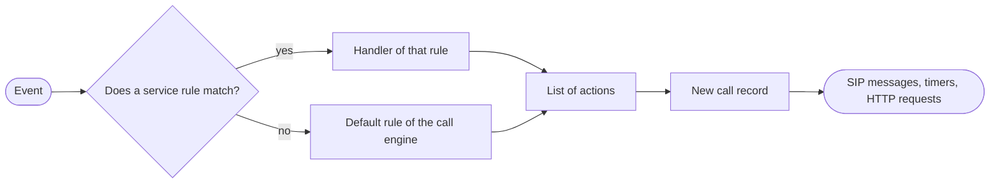
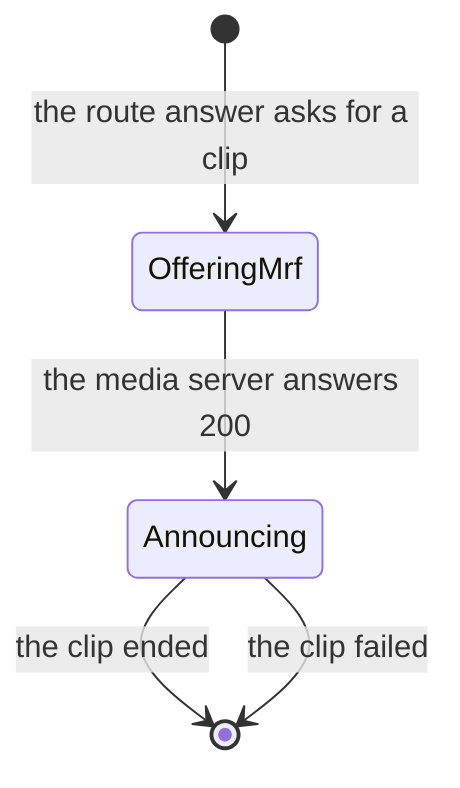

# The service model

A service is a small state machine that lives in one call. It gets the events of the call, and
it answers with actions. The call engine does the rest: SIP transactions, dialogs,
retransmissions, replication. This page is the reference for a service author. Read
[services.md](services.md) first for the overview and the worker binary.

A service crate depends on `b2bua-sdk` alone. `use b2bua_sdk::rules::*` gives the matcher, the
actions, the context of a handler and the types of the call model that a service names, such as
`TimerKey`, `TimerType`, `Direction`, `LegState` and `LegKind`. The macros are
`b2bua_sdk::{define_service, sm_rule}`.

## One turn

The engine handles one event of a call at a time. This unit of work is a turn.



1. An event arrives for the call.
2. The engine looks for the first rule that matches. It tries the rules of the services before
   its own default rules. Only the rules that protect the call after a failover run before a
   service.
3. The handler of that rule returns a list of actions. It does nothing else.
4. The engine applies the actions to the call record, replicates the record, and sends the
   messages.

A handler is a function with no effect of its own. It reads the call and the event, and it
returns actions. It cannot send a message or keep a variable. The engine gives it the current
time with the event. This is what makes a service safe to replicate and exact to test.

If a handler returns `None`, the engine tries the next rule. With no service rule, the default
rule of the engine applies. Thus a service changes the behaviour only for the events it takes.

## Events

A rule states the event it takes with a matcher.

| Event | Matcher | It occurs when |
|---|---|---|
| SIP request | `Match::request().method("INFO")` | A request arrives on a leg. |
| SIP response | `Match::response().method("INVITE").status_class(2)` | A response arrives on a leg. |
| Timer | `Match::timer().service_timers(MACHINE)` | A timer of the call fires. |
| Transaction timeout | `Match::timeout()` | A request that the worker sent got no final response. |
| CANCEL | `Match::cancelled()` | A CANCEL matched an INVITE that the worker received: the first INVITE of the caller, or a re-INVITE. `ctx.cancelled_in_dialog()` tells them apart. |
| HTTP result | `Match::internal_event().topic("service-http-result")` | An HTTP request of the service got its answer, or its deadline passed. |
| Attempt started | `Match::attempt_started()` | A routing answer starts to call its targets. |
| Attempt ended | `Match::attempt_ended()` | That attempt got its result. |
| Leg ended | `Match::leg_ended()` | A leg of the call ended. |

A matcher can add conditions: the direction (`direction`), the state of the leg (`leg_states`),
a status code (`status_code`), and a function of your own (`filter`).

A service rule gets no event after the termination of the call starts. From that moment, the
engine ends the call with its own rules.

The last three events are lifecycle events. The engine sends them to each active service at the
end of a turn, whichever rule handled the turn. A handler of a lifecycle event can do three
things only: write service data, change the state of its machine, and arm or cancel its own
timers. The engine drops any other action and records a defect of the service.

## The state machine

```rust
define_service! {
    id: "announcement",
    machine: MACHINE,
    states: State { OfferingMrf, Announcing },
    init: |call: &RuleCall| { /* returns Option<ServiceSeed> */ },
    rules: [ /* sm_rule! { ... }, ... */ ],
}
```

- **States.** A service names its states. The engine keeps the current state of each service in
  the call record. It is the only place where the state lives.
- **Start.** `init` runs one time, when the call starts. It returns the first state, or `None`
  if the call does not use the service. A call that does not use a service pays nothing for it.
- **Active states.** A rule names the states in which it applies (`active`). In any other state,
  the engine does not try the rule.
- **Transitions.** A rule changes the state with the action `SetState`. It names the changes it
  can make (`transitions`).
- **End.** A rule ends the machine with the action `ClearState`, declared as a transition to
  `Terminal`. From then on, the default rules of the engine handle the call.

`init` can do more than select the first state. It can write the first data of the service and
return a first list of actions. The announcement service uses this to call the media server
while the call starts.

The engine compares each turn with the declarations of the rule. If a rule makes a transition
that it did not declare, the engine records a defect of the service.

## Actions

A handler returns actions. These are the ones a service uses most.

| Purpose | Actions |
|---|---|
| Relay the message that arrived | `RelayToPeer`, `RelayToLeg` |
| Answer the request that arrived | `Respond` |
| Send a message of the service | `SendRequestToLeg`, `SendProvisionalToLeg`, `SendReinvite` |
| Report the progress of a transfer | `SendNotify` |
| Complete a dialog | `ConfirmDialog`, `AckLeg` |
| Add or remove a leg | `CreateLeg`, `CancelLeg`, `DestroyLeg`, `TerminateLeg` |
| End the call | `BeginTermination`, `TerminateCall` |
| Use a timer | `ScheduleTimer`, `SnoozeTimer`, `CancelTimer` |
| Hold a request and answer it later | `HoldRequest`, `AnswerHeld` |
| Ask a backend | `ServiceHttpRequest` |
| Keep data | `MergeCallExt` |
| Change the state of the machine | `SetState`, `ClearState` |

The rule owns the meaning of a message: the method, the body, the target leg and the headers it
needs. The engine fills the mechanical part: Via, CSeq, tags, Contact, and the retransmissions.

A rule declares the kinds of effects it can have (`effects`): a message on a leg, a command on
the life of the call, a timer. The engine compares the actions of each turn with the
declaration. The same declarations produce the state diagram of the service. The diagrams of
the services in this repository are in [docs/sm/](../sm/).

## Timers

A service arms a timer for a delay. When the delay ends, the call gets a timer event.

- **Key.** A timer has a key, `TimerKey`: a type and a scope. The type of a service timer
  names the service and the timer. The scope is what the timer guards: the call, one attempt,
  or one leg. Two more scopes exist, and only the engine uses them.
- **Arm.** `RuleAction::arm(key, TimerDelay::secs(10))`. A call holds one timer for each key.
  If you arm a key again, the new timer replaces the old one. A delay is at most
  `MAX_DELAY_MS`, about 24.8 days: the engine arms a longer one at that maximum and records a
  defect.
- **Cancel.** `RuleAction::cancel(key)`.
- **Fire.** A rule takes the event with `Match::timer().service_timers(MACHINE)`. The handler
  reads the full key with `ctx.timer_key()`. `ctx.service_timer_key()` gives the service and
  the name of the timer, with no scope.
- **Declare.** A rule that arms, snoozes or cancels a timer declares it in its `effects`. The
  declaration gives the type of the timer and the kind of its scope. Without it, the engine
  records a defect each time the rule uses the timer.

The type of the timer is a constant of the service:

```rust
use b2bua_sdk::rules::{TimerKey, TimerType};

const WATCHDOG: TimerType = TimerType::service(MACHINE, "clip-watchdog");
```

A handler returns this action to guard one leg for 10 s:

```rust
RuleAction::arm(TimerKey::leg(WATCHDOG, media_leg_id), TimerDelay::secs(10))
```

The rule lists this entry in its `effects`:

```rust
Effect::GuardTimer { timer: WATCHDOG, scope: TimerScopeKind::Leg, label: "clip watchdog" }
```

`TimerKey::call` and `TimerKey::attempt` make a key for the two other scopes.

Two properties remove the usual defects of timers (ADR-0042).

1. **A timer ends with its scope.** When a leg ends, the engine removes the timers of that leg.
   When a service ends its machine, the engine removes the timers of that service. A rule never
   cancels a timer that its scope already removed.
2. **An old timer never arrives.** The engine drops the fire of a timer that was replaced,
   cancelled or removed. A handler of a timer event thus handles a live timer. It checks its
   business conditions only.

A service gives a delay, never a clock time. The copy of a call can run on a worker with a
different clock. The engine corrects the times of the timers when it moves a call.

### Snooze

Sometimes a deadline arrives at a bad moment, for example while a re-INVITE is in progress. The
rule that takes the timer event can put the deadline off by a short step. This is a snooze.

- `RuleAction::snooze(key, delay)` arms the same timer again, to fire `delay` from now.
- The engine counts the snoozes of each key. `ctx.call.snoozes(&key)` returns the count.
- A fresh `arm` of the key sets the count to zero.

The engine does not limit the count. Your rule must, as in this sketch:

```rust
fn on_deadline(ctx: &RuleContext) -> Option<RuleHandleResult> {
    let key = ctx.timer_key()?.clone();
    if exchange_in_progress(ctx) && ctx.call.snoozes(&key) < 5 {
        return Some(RuleHandleResult::new(vec![
            RuleAction::snooze(key, TimerDelay::secs(1)),
        ]));
    }
    Some(RuleHandleResult::new(act_on_the_deadline(ctx)))
}
```

The rule looks again one second later, five times at most. `exchange_in_progress` and
`act_on_the_deadline` are functions of the service. The rule must declare the timer in its
`effects`, as for an arm. A snooze is in the call record, so the count continues on the backup
after a failover.

## A request that waits for a later turn

A service can need a later event before it answers a request. For example, it gets an INFO, asks
a backend, and answers the INFO when the backend answers.

- `HoldRequest` keeps the request. The engine sends no answer now.
- `AnswerHeld` answers it in a later turn, with a status and a body. It names the request by its
  leg and its CSeq number. The later turn does not have the request, so the service must keep
  the two values in its data when it holds.
- The engine gives each held request a deadline, below the timeout of its sender. If the service
  did not answer at the deadline, the engine answers 500.

A service can hold a request inside a dialog only. It cannot hold an INVITE, an ACK or a CANCEL.
The engine answers 500 to an attempt to hold one.

## A request to a backend

`ServiceHttpRequest` sends an HTTP request and returns immediately. The call continues to take
events. The answer arrives later as an event of its own.

| Field | Meaning |
|---|---|
| `correlation_id` | An identifier that the service selects. The result brings it back, so a rule can match its own request. It must be different for each request of the call that waits for its answer. |
| `endpoint` | A logical path. The worker binary maps it to a base URL. |
| `method`, `headers`, `body`, `content_type` | The request. The body is binary. |
| `timeout_ms` | The time limit. The engine caps it, at 26 s by default. |

The result is an event with the topic `service-http-result`. Its outcome tells you if the
request got an answer. Its body is the answer, byte for byte.

Three cases need care:

- **No answer.** If the answer is lost, the engine sends the result 2 s after the time limit,
  with the error `no_answer`. A rule gets one result for each request, unless the termination
  of the call starts first.
- **A repeat.** The backend can get one request more than one time. The HTTP client sends a
  request again after a connection failure, and the backup can send it again after a failover.
  The backend must accept a repeat.
- **A late answer.** An answer that arrives after the deadline reaches no rule.

## The data of a service

A service keeps its data in the call record, as one JSON value under its own identifier.

- The routing decision can give the first value. A route answer carries data for each service
  that it starts.
- A handler reads the value with `ctx.call.ext()?.get(ID)`. `ext()` returns the values of all
  the services.
- A handler writes it with the action `MergeCallExt`.
- The value replicates with the call. Its size limit is 120 KiB by default. The engine ends a
  call that passes the limit. See [overload.md](overload.md#bounds-on-one-call).

Do not keep a fact about a call in any other place. A table in memory does not exist on the
backup.

## Example: the announcement service

The sample service in `crates/announcement` plays a clip to the caller before it calls the real
destination. It has two states and four rules.



| State | Event | Actions of the rule |
|---|---|---|
| Start (`init`) | The route answer has data for the service | Go to `OfferingMrf`. Create a media leg to the media server. |
| `OfferingMrf` | 200 OK on the media leg | Confirm and ACK the media dialog. Send the SDP of the media server to the caller in a 183. Send an INFO that starts the clip. Go to `Announcing`. |
| `Announcing` | INFO from the media server: the clip ended | Answer the INFO. Send a BYE on the media leg. Call the real destination. End the machine. |
| `Announcing` | INFO from the media server: the clip failed | Answer the INFO. Send a failure response to the caller. End the call. |
| Any state | Failure response on the media leg | Relay the failure to the caller. End the call. |

After the third row, the service is gone. The destination is a normal leg, and the default
rules of the engine connect it to the caller. The service has no code for the answer, the ACK,
the BYE or the CDR of the call.

The full source is in `crates/announcement/src/`.

## How to write a service

1. List the states of your service and the event that moves it from one state to the next.
2. Write `init`. Return `None` for a call that does not use the service.
3. Write one rule for each event in each state. Keep each handler short.
4. Declare the transitions and the effects of each rule.
5. Arm a timer for each wait that can have no end. Give the timer the scope it guards.
6. Keep all data in the value of the service.
7. Write a test for each call flow with `b2bua-harness`. See
   [services.md](services.md#how-to-test-a-service).
8. Add your call flows to the failover tests with `failover_sweep!`.
