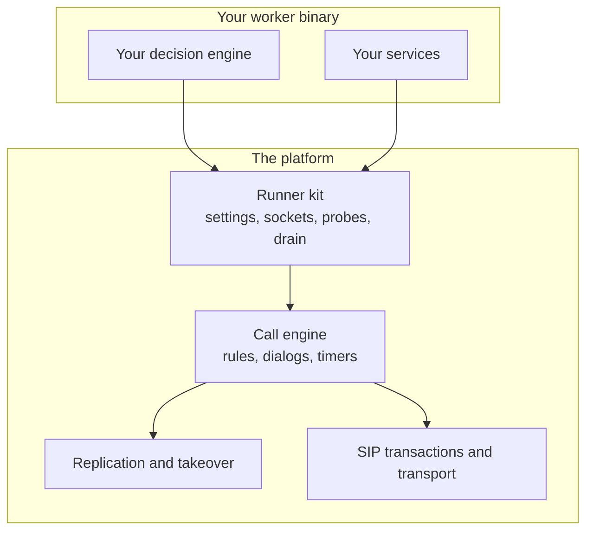

# Call logic: how to extend it

The platform is a container for SIP call logic, in the manner of a telecom application server.
The call engine is a complete B2BUA. It handles SIP transactions, dialogs, timers, replication
and overload. You supply the routing decision and, if you need them, services that change the
call flow. This page shows the two extension points and the worker binary that joins them.

Three differences from a JAIN SLEE container are important:

- the service interface is the Rust SDK of this project, not a standard;
- a service compiles into the worker binary. You cannot deploy a service into a worker that
  runs;
- the platform speaks SIP, and HTTP to your backends. It has no adaptors for other protocols.

## The parts



| You write | Against | To do what |
|---|---|---|
| A decision engine | The `b2bua-decision` crate | Route, reject or redirect each new call, and decide the next step when a route fails. |
| Services (optional) | The `b2bua-sdk` crate alone (`b2bua_sdk::rules`) | Add steps to the call flow: play an announcement, change early media, control a transfer. |
| A worker binary | The `b2bua-runner-kit` crate | Join your engine and services to the platform, in a few lines. |

With no service, the call engine is a full B2BUA: it relays a call between two legs, with
PRACK, UPDATE, re-INVITE, CANCEL, keepalive, teardown and a CDR. This default behaviour is the
part of the platform that is built and tested to production standards.

The repository has a reference worker, `b2bua-runner`. It routes each call to one fixed
destination and reads optional routing orders from an `X-Api-Call` header. Use it to evaluate
the platform and to run load tests. Its routing is a test component, so it is not a production
binary. A production worker is your own binary, with your decision engine.

## The decision engine

The engine is one trait, `CallDecisionEngine`, with four methods. The call engine calls a method
and applies the answer.

| Method | The call engine calls it when | Your answer |
|---|---|---|
| `new_call` | A new INVITE arrives | Route, redirect or reject |
| `call_failure` | A route fails: a final response, no answer, a limiter refusal | Route to the next target, redirect, reject, or relay the failure to the caller |
| `call_refer` | A callee asks for a transfer with REFER | Allow, with the target, or reject |
| `call_release` | An event you subscribed to occurs, such as the maximum duration | Release the call, or route it again |

The request gives you the full INVITE: the Request-URI, From, To, each header in wire order, and
the body.

A route answer can set these items:

- the destination: host, port and transport;
- a new Request-URI, From URI and To URI;
- headers to add or remove;
- the body: keep it, drop it, replace it, or attach parts to it;
- the no-answer time and the maximum duration of the call;
- limiter entries, each with a key and a limit, that the call must hold;
- features for the call, such as the handling of the first 18x or of REFER;
- data for a service;
- a context of your own, which you get back on the next request for the same call.

The context is how you build a plan of several routes. Put the list of the next targets in
it. On `call_failure`, take the first one and return the others. The context travels in the
call record, so a plan continues after a failover.

**Who owns each header.** Your engine owns the Request-URI, the From and To URIs and the headers
it adds. The call engine owns the tags, Via, CSeq, Call-ID and Max-Forwards. An answer cannot
change them (ADR-0017).

**Time.** The engine has 5 s for a call setup, all requests together. After that the caller
gets 503. See [overload.md](overload.md#the-first-invite-always-gets-a-final-response).

## A service

A service is a state machine that lives in the call. It has states, and rules that apply in
given states. A rule matches an event, returns actions, and can move the machine to a different
state.

This is a complete service with one rule. It compiles against `b2bua-sdk` alone.

```rust
use b2bua_sdk::rules::{
    Effect, Match, Method, RuleCall, RuleContext, RuleHandleResult,
};
use b2bua_sdk::{define_service, sm_rule};

fn advance(_ctx: &RuleContext) -> Option<RuleHandleResult> {
    None
}

define_service! {
    id: "stub",
    machine: STUB_MACHINE,
    states: StubState { S0, S1 },
    init: |_call: &RuleCall| None,
    rules: [
        sm_rule! {
            id: "stub-advance",
            machine: STUB_MACHINE,
            active: [ StubState::S0 ],
            transitions: [ StubState::S0 => StubState::S1 ],
            effects: [ Effect::Originate { method: Method::Info, label: "INFO → leg" } ],
            matcher: Match::request().method("INFO"),
            handle: advance,
        },
    ],
}
```

| Field | Meaning |
|---|---|
| `init` | Runs when the call starts. It returns the first state and the data of the service, or `None` if the service does not apply to this call. |
| `active` | The states in which the rule can match. |
| `matcher` | The event the rule takes: a request, a response, a timer, an answer from a backend. |
| `handle` | The function that returns the actions. `None` passes the event to the next rule. |
| `transitions` | The state changes the rule can make. |
| `effects` | The kinds of messages and commands the rule can send. |

A rule of a service is tried before the default rules of the engine. Thus a service changes
the default behaviour only for the events it takes. Only the rules that protect the call after
a failover run before a service.

[service-model.md](service-model.md) is the reference for a service author. It covers the
events, the state machine, the actions, and timers with their snooze. It also covers a request
held for a later turn, a request to a backend, and the data of a service.

**Events.** A rule sees:

- SIP requests and responses;
- timers and transaction timeouts;
- a CANCEL of an INVITE that the worker received;
- the answers to its own HTTP requests;
- the start and the end of each routing attempt, and the end of each leg.

**Actions.** A rule can:

- relay a message, or answer it;
- hold a request and answer it later;
- create or end a leg;
- send a request or a provisional response on a leg;
- start or cancel a timer;
- send an HTTP request;
- write its own data and change its state;
- end the call.

**Declared effects.** The engine compares what a rule did with its `transitions` and `effects`.
It records a difference as a defect of the service. The same declarations produce a state
diagram for each service. A test fails if a committed diagram is out of date. The diagrams of
the services in this repository are in [docs/sm/](../sm/).

### Services in the repository

Two services are built in. They are part of the call engine, under the same checks, and their
call flows are in the failover tests. A route answer turns each one on for a call.

| Built-in service | What it does |
|---|---|
| `relayFirst18x` | Shows the caller one early dialog when the call forks. It sends the first 18x as a 180 with no body. A policy that you select says which later 18x it relays, and a strategy says what it does with their SDP. |
| `transfer` | Blind transfer on REFER. It asks your decision engine, calls the target, and realigns the media of the two parties. It refuses a REFER with Replaces (501). |

One service is a sample.

| Sample service | What it does |
|---|---|
| `announcement` | Plays a clip from a media server as early media, then calls the real destination. It controls the media server with MSCML over INFO. |

`announcement` shows how to write a service outside the engine. It is in its own crate, and it
depends on the SDK alone. Read
`crates/announcement/src/lib.rs` as the model for a service of your own.

It is a sample for two reasons. Its crate has no tier, so the purity check and the panic-site
count of [engineering-rules.md](engineering-rules.md) do not cover it. And the reference worker
does not run it. The other checks apply: its crate cannot see HA, it has no `unsafe`, and its
call flow is in the failover tests.

## The worker binary

The runner kit holds all the code between the environment variables and a worker that runs. That
is the settings, the sockets, the probes, the CDR sink, the replication and the drain. Your
binary selects the decision engine and the services.

```rust
async fn run(
    my_engine: std::sync::Arc<dyn b2bua::decision::CallDecisionEngine>,
) -> Result<std::process::ExitCode, String> {
    let base = b2bua_runner_kit::RunnerEnv::from_env()?.bind("my-runner").await?;
    let cdr_sink = base.cdr_sink_from_env()?;
    let mut deps = base.deps(my_engine, cdr_sink).await;
    deps.replication = base.replication_setup_from_env().await?;
    let services = Vec::new(); // your ServiceDefs
    let core = base.spawn(deps, services, b2bua_runner_kit::ConfigCheck::new())?;
    let _probe = base.spawn_probe_server(&core, None, None).await;
    base.spawn_gauge_sampler(&core);
    Ok(base.run_until_shutdown(&core).await)
}
```

Two lines of this example are easy to forget. Without `cdr_sink_from_env`, the worker discards
its CDRs. Without `replication_setup_from_env`, the worker replicates nothing, and the
`B2BUA_REPL` settings have no effect.

Each dependency has a default that you can replace before `spawn`: the call store, the CDR
writer and its format, the limiter client, the replication. `ConfigCheck` takes the relations
between your own settings. The worker then refuses to start on a bad set, with the same message
format as the platform checks.

## What the engine does for a service

A service author writes logic for one worker. The engine supplies the rest (ADR-0055).

| You do not write | Because |
|---|---|
| Replication of the state of your service | The state is in the call record, and the engine replicates the record. |
| Code for a takeover or a restart | No event and no setting carries an HA value. A service cannot see a failover. |
| A check for an old timer | A timer names its scope. The engine drops a timer whose scope ended. |
| Retransmissions, CSeq, tags, Via | The transaction and dialog layers own them. |
| A release of resources at the end of a call | The engine releases each leg, timer and limiter hold when the call ends. |

A script checks the separation. The service crates cannot depend on the
replication crates, and they cannot use the words of the replication code.

### The four rules a service must follow

1. **Keep each fact about a call in the call record.** No table in memory outside it.
2. **Send a request to a backend for its answer only.** A backend can get the request two
   times after a failover. It can get none if the call ends first.
3. **Accept that the call can end at any time.**
4. **Keep durations, not clock times.** A copy of the call can run on a host with a different
   clock.

Two more limits apply. A service can hold a request that is not an INVITE and answer it in a
later turn, with a deadline. It cannot hold an INVITE. And a loop in a service must have a
bound, see [engineering-rules.md](engineering-rules.md).

## SIP coverage of the call engine

| Area | Support |
|---|---|
| Methods | INVITE, ACK, CANCEL, BYE, OPTIONS, UPDATE, INFO, REFER, NOTIFY, PRACK, MESSAGE |
| Reliable provisional responses (RFC 3262) | Yes |
| UPDATE (RFC 3311) | Yes |
| Early media, P-Early-Media (RFC 5009) | Yes, with strategies for forked calls |
| Blind transfer (RFC 3515) | Yes, with the NOTIFY subscription |
| Forked calls: several early dialogs on one leg | Yes |
| Crossed requests | Yes: 491 on a re-INVITE that crosses a re-INVITE |
| Multipart bodies (RFC 5621) | Yes: keep, replace, attach parts |
| Privacy (RFC 3323), Reason (RFC 3326), P-Charging-Vector (RFC 7315) | Yes |
| Session timers (RFC 4028) | Relayed end to end. The worker runs no session timer of its own. |
| Redirection | The worker can send a 3xx. It does not follow a 3xx from a callee. |
| Transport | UDP |

Not supported: TCP and TLS, digest authentication, REGISTER, attended transfer (Replaces), DNS
SRV for a destination, and media. The worker handles signalling only. RTP flows between the
endpoints or through your media servers.

## How to test a service

The test crates of the repository are available to your service.

- `b2bua-harness` runs a real call engine with simulated parties and a clock that the test
  controls. A call of 5 minutes runs in milliseconds.
- Each test ends with two checks that you get with no code. The first is an audit of all
  messages against the RFC rules. The second is a check that the engine released the call.
- `failover-harness` runs a proxy and several workers in one process. The `failover_sweep!`
  macro cuts your call flow at each step with each incident. Your service gets the HA proof of
  [ha.md](ha.md#how-the-guarantee-is-proven) with a list of call flows and no HA code.
